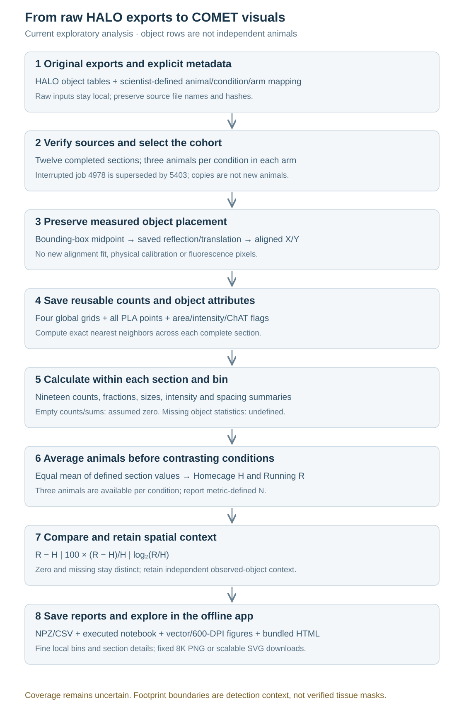
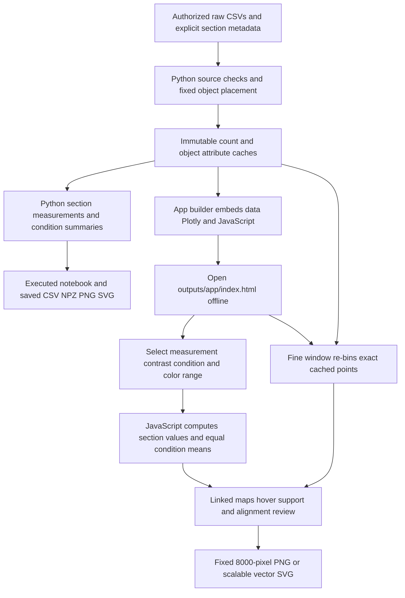

# COMET repository appendix

This appendix explains how the repository turns HALO object tables into the current spatial measurements, scientific report and interactive Explorer. It is written for scientists who want to understand the calculations and for collaborators who need to find or change the code. The current analysis has **19 section-level measurements**, **three condition comparisons**, **three animals per condition**, and separate TDP43–HK1 and TDP43–PFKP arms. The same six animals occur in both arms.

The [complete file catalog](file_catalog.md) gives every selected repository file its own entry, including source code, tests, metadata, notebooks, tables and individual rendered figures. The other chapters explain what that file list means and how the pieces connect. Scientific outputs describe detected objects and their measured attributes; they do not supply original fluorescence pixels, validated tissue coverage, physical calibration or additional animals.

## Reading routes

| What you want to understand | Start here |
|---|---|
| The full path from raw files to app visuals | The diagram and worked trace below |
| Every measurement, its equation, units, denominator and missing-value rule | [Calculations and interpretation](calculations.md) |
| What each Python/JavaScript/template file does and which functions call it | [Code reference](code_reference.md) |
| Root files, notebooks, dependencies, metadata, documents and individual tests | [Repository guide](repository_guide.md) |
| One specific file, including a generated PNG, CSV, JSON or NPZ | [Complete file catalog](file_catalog.md) |
| A machine-readable record of all file paths, source entry points and data fields | [File inventory](file_inventory.json) |
| Opening or rerunning the app | [Main README](../../README.md) |

## From raw exports to visuals



The diagram is a scalable SVG, so the text and arrows remain sharp when enlarged. The individual chapters also contain Mermaid flow diagrams that GitHub can render directly. The numbered stages mean:

1. **Keep the source and the experiment connected.** Raw CSV files contain object measurements. Explicit metadata supplies animal, condition, physical section, PLA arm and source relationships. A name that resembles an animal ID does not independently establish that identity.
2. **Check the cohort before counting.** The selected study has twelve completed exports. Interrupted job 4978 is retained as audit history and superseded by completed job 5403. Historical copies, reruns, rows and repeated appearances of the same animal do not create biological replication.
3. **Place objects without inventing images.** The code uses bounding-box midpoints and the frozen section reflection/translation matrices. This reproduces the accepted exploratory placement; it does not refit anatomy, construct serial 3D tissue or recover microscope pixels.
4. **Save reusable measured information.** Global count grids retain all source objects; linked point and attribute caches preserve every selected PLA object's identity, source row, native/aligned position, area, exported intensity and ChAT flag. Nearest-neighbor distances search the entire same-section PLA population before any local binning.
5. **Calculate within sections.** Every selected measurement is first calculated for one physical section and one spatial bin. Counts, summed areas and section shares can have formula-defined empty-bin zeros. Object means, percentiles and within-bin fractions can be undefined. A zero and a missing value are different outcomes.
6. **Average animals before comparing conditions.** Defined section values have equal weights within each condition and arm. Three animal sections are available; the number defining an object statistic can be lower at a particular location. Objects are not pooled as independent animals.
7. **Calculate the contrast and retain context.** The app can show signed Running minus Homecage, percent change relative to Homecage, or a log₂ ratio. Undefined ratios stay missing. The independent observed-object footprint stays visible so missing statistics do not erase spatial context; that footprint is not a tissue mask.
8. **Save and inspect the result.** The notebook provides methods, numerical checks, saved figures and interpretation. CSV/NPZ files retain values and support information. The offline HTML bundles the data and browser code. Its controls can calculate a new measurement/cutoff or genuinely finer local bins from the caches without rereading raw CSVs.

## Follow one object through the code

The following numbers are an **illustrative arithmetic example**, not results or extra specimens from this study.

Suppose a PLA object has `XMin = 100`, `XMax = 120`, `YMin = 200`, `YMax = 240`, exported area `0.15`, and ChAT flag `1`.

```text
Native midpoint:
  x = (100 + 120) / 2 = 110
  y = (200 + 240) / 2 = 220

Illustrative allowed saved transform:
  aligned x = 1000 − x = 890
  aligned y = y − 50 = 170

With 100-unit bins:
  x bin = [800, 900)
  y bin = [100, 200)
```

The fixed transform moves the coordinate used for bin membership; it does not change the exported area or ChAT flag. This object contributes one to that section-bin's PLA count, one to its large count at a cutoff of 0.1, one to its ChAT-associated count, and 0.15 to the appropriate area sums. The bin's means, fractions and percentiles require the rest of the objects in the same section-bin. The object's nearest neighbor can be outside this bin because that search uses the full physical section.

Now suppose the three Homecage section-bin counts are `[0, 4, 8]` and the three Running counts are `[3, 6, 9]`:

```text
Homecage H = (0 + 4 + 8) / 3 = 4
Running  R = (3 + 6 + 9) / 3 = 6

Signed difference = R − H           = 2 PLA detections/bin
Percent change    = 100 × (R − H)/H = 50%
Log₂ fold change  = log₂(R/H)        ≈ 0.585
```

These are three ways to compare the same condition means. They are not three independent experiments. If the Homecage mean were zero, its percent-change denominator would be zero and the app would leave that comparison undefined. The [calculation chapter](calculations.md) works through the other statistics, including the different averaging rule when no required objects exist.

## Offline building and browser interaction are different stages



[Open this flow diagram as scalable SVG](diagrams/overview_flow_1.svg)

**Opening the saved app** needs no Python, raw CSVs, former-project folder or internet. The optional Python server only serves `outputs/app` locally; it does not run the analysis. **A full raw recount** needs the original authorized inputs and matching hashes. **A cached notebook rerun** needs the selected count and attribute caches but does not need the original CSVs. These routes and the exact commands are in the [repository guide](repository_guide.md#viewing-rerunning-and-validation-boundaries) and [main README](../../README.md).

The 8,000-pixel PNG setting is now fixed to keep downloads simple. More export pixels would change the saved image dimensions, not the measurements or on-screen detail. For genuinely smaller calculated bins, use **Open fine detail → Spatial detail: calculated bin width**. Its 100/50/25/10-unit choices recompute local bin membership from the original positions. Smaller bins often contain fewer objects and fewer defined section values; apparent sharpness is not extra biological certainty.

## Current results and historical material

| Layer | Role in this repository |
|---|---|
| Current twelve-section comparison | Nineteen measurements, defined-section condition means and three contrasts; counts retain the scientist-directed empty-zero rule |
| 14 November policy | Explicit authorization for three-section count averages, reused alignment and uncertain tissue coverage |
| 17 November calculation instructions | Original thirteen measurement definitions and three comparison formulas |
| 19 November extensions and later export cleanup | Six extra descriptive measurements, persistent footprint, finer local calculations and fixed 8K PNG downloads |
| Earlier observed-support means | Historical estimator using sections with detections; its raw counts/positions are reusable, but its old means are not the current means |
| Original strict tissue-mask workflow | Separate whole-bin containment/centroid/approval requirements; blocked strict inputs do not invalidate the authorized exploratory comparison |
| Earlier native supporting report/app | Original eight-export intake and descriptive QC; different sample/coordinate scope and some shared-output rerun side effects |
| Former PLA–ChAT project | Methodological/code provenance and historical findings; its biological conclusions are not expected outcomes for this experiment |

The code reference identifies which commands overwrite a notebook or shared report file. Read those entry points before regenerating older reports. Current `latest_run.json` pointers identify the selected immutable results; filenames and historical documents alone should not override them.

## What is verified and what it means

The repository records source hashes and object-order/coordinate checks, count conservation, Python/JavaScript numerical agreement, original-array preservation, executed notebook outputs, export geometry and software tests. These checks address reproducibility and implementation behavior. They do not independently establish tissue presence, calibration, correct segmentation, biological specificity, matched anatomy or causality.

The current support maps count sections containing detections. A location can have object support but no PLA size mean; a condition can have a defined assumed-zero count but uncertain tissue presence. The appendix keeps **animal N**, **observed-support N**, **measurement-defined N**, **object count**, **pixel size** and **spatial-bin width** separate throughout.

## Maintaining this appendix

The explanatory chapters are reviewed prose tied to named source functions. The catalog is generated from the selected Git files so repeated artifacts are not silently omitted:

```bash
python scripts/build_repository_appendix.py
python scripts/build_repository_appendix.py --check
```

From a source staging folder with a separate Git checkout, add `--repository /path/to/TDP43_Analysis`. A downloaded ZIP can use the included machine-readable inventory. The utility reads file structure/headers, source entry points and notebook output counts; it does not execute analysis or modify raw data. Update the prose when a method changes, then regenerate the catalog and check its links before the next publication.

The six SVG copies of Mermaid flows are rendered snapshots of their corresponding code blocks. If a Mermaid block changes, rerender that SVG with a compatible [Mermaid renderer](https://mermaid.js.org/config/usage.html) and refresh its source/output hashes in `diagrams/diagram_manifest.json`. The catalog check detects stale copies; regenerating the catalog alone does not redraw those six diagrams. The numbered overview SVG is drawn directly by the Python appendix utility.
