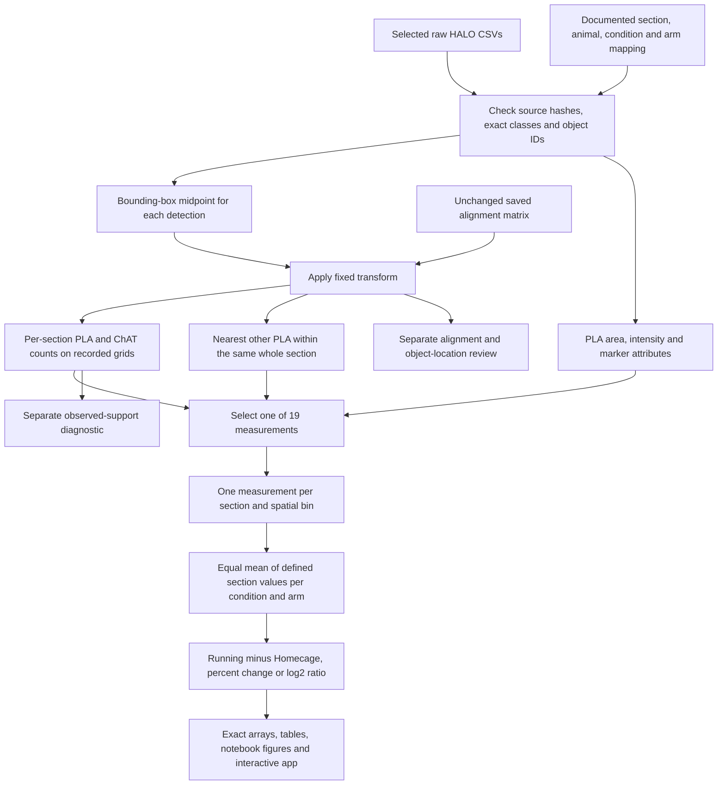
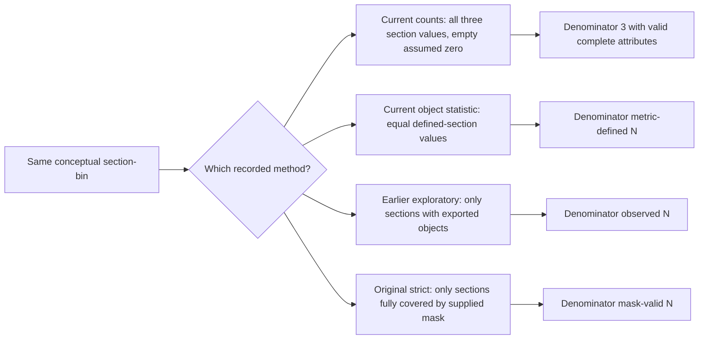

# Every calculation, from exported objects to displayed maps

This appendix describes the calculations implemented in this repository as of 19 November 2026. It explains the current analysis first, then the earlier methods retained for provenance and review. Equations describe the code's actual behavior; they are not additional biological assumptions or statistical tests.

For viewing and rerunning, start with the [project README](../../README.md). The [appendix overview](README.md), [repository guide](repository_guide.md), [code reference](code_reference.md) and [file catalog](file_catalog.md) explain the surrounding files. A separate [raw-data-to-visuals diagram](diagrams/data_to_visuals.svg) provides a printable overview.

## 1. The experiment and the calculation order

The selected cohort contains **six animals**, with three animals per condition. Homecage animals are **21F, 23M and 24M**; Running animals are **22F, 21M and 22M**. Each animal contributes one physical section to each of two separate PLA arms, **TDP43–HK1** and **TDP43–PFKP**. There are twelve retained sections, not twelve independent animals. The same animals appearing in both arms do not create independent replications of a condition effect.

The selected completed exports contain 3,010,776 detections: 310,024 PLA and 2,700,752 ChAT. Interrupted job 4978 is retained in the source audit but superseded by completed job 5403 for analysis. The eight earlier `Initial Data` exports include overlapping analyses; adding them to the completed cohort would double-count evidence. Explicit section assignments and source relationships are recorded in [the analysis manifest](../../metadata/analysis_manifest.json) and [cohort selection](../../metadata/cohort_selection.json).

The **animal is the biological experimental unit**. A section supplies the spatial measurement for that animal within its arm. Objects and spatial bins are measurement subdivisions, not extra biological replicates. Current comparisons are descriptive: the code does not calculate p-values, confidence intervals, causal exercise effects or validated cell identities.



[Open this flow diagram as scalable SVG](diagrams/calculations_flow_1.svg)

The key ordering is **objects → section-bin statistic → condition mean → condition comparison**. For example, a map of mean PLA area averages the three section-level mean areas where defined. It does not first pool all PLA from the three animals. See [the Python measurement engine](../../comet_spatial/measurements.py) and [its browser counterpart](../../scripts/comet_measurements.js).

## 2. What is read from a raw object row

The raw reader recognizes exactly two exported object classes: `PLA - TRITC_E1` and `ChAt-50 - FITC_E1`. An unexpected class, malformed row, duplicate/missing object ID, nonfinite box or reversed box stops counting. Object IDs are required to be unique within an export; an ID alone does not establish correspondence between different exports.

For each box, the location proxy is:

`native_x = (XMin + XMax) / 2`

`native_y = (YMin + YMax) / 2`

A box from X=10 to 14 and Y=20 to 26 therefore supplies point (12, 23). This is the center of the bounding box, **not a measured object centroid**, microscopy pixel reconstruction or proof of a cell's center. Every selected detection is retained; displayed dots do not establish individual molecules or cells.

PLA measurements are read from `Area (µm²)`, `Average Intensity` and `ChAt-50 - FITC_E1 present` **on the PLA object's row**. The available non-self marker is currently ChAT. HK1 and PFKP name separate PLA arms; their presence in an arm name does not supply additional marker-association columns. Counting separate ChAT-class detections is also different from reading a PLA object's ChAT flag.

The area unit is **µm² as labeled in the export**; calibration has not been independently verified. Intensity has exported intensity units with no established calibrated fluorescence scale. Spatial coordinates and nearest-neighbor distances use exported coordinate units with unverified physical calibration. Neither a fine bin nor a large output image justifies a physical scale bar.

[The raw-count reader](../../comet_spatial/exploratory.py) checks source SHA-256 before and after reading. [Attribute extraction](../../comet_spatial/measurement_features.py) additionally matches each PLA's object ID and source record number to the existing ordered point cache, recomputes the native midpoint and transformed point, and requires exact agreement. Attributes cannot silently attach to another object's coordinates.

## 3. Fixed alignment, grids and counting

### Applying the saved transform

[`FixedTransform`](../../comet_spatial/core.py) applies the supplied affine matrix to column coordinates:

```text
[aligned_x]   [m00 m01 m02] [native_x]
[aligned_y] = [m10 m11 m12] [native_y]
[    1    ]   [ 0   0   1 ] [   1    ]
```

The class checks a finite, invertible 3×3 affine matrix. It never estimates registration. The selected saved transforms implement the previously chosen translations and discrete reflections. They do not refit rotation, scale, warp tissue, move individual detections or invent missing tissue. In the saved landmark convention, reflection signs `sx, sy` give `aligned_x = sx × (native_x − landmark_x)` and the corresponding Y expression. Each arm has its own saved reference; matching numeric axes does not create cross-arm anatomical registration.

Coordinates increase rightward in X and downward in Y in the current views. Reversing an axis on screen changes how coordinates are drawn, not which numeric bin contains an object. Camera motion in a historical 3D display likewise changes the view, not registration or a measurement.

### Bin membership and count conservation

A bin is a rectangle between recorded X and Y edges. Its lower numeric edges are included and upper edges excluded, **except the outermost maximum edges**, which enter the last bin. On edges 0, 100 and 200, X=100 enters the second bin, and X=200 also enters the second. A corner is counted once. Arrays use `[y_bin, x_bin]`, so rows are Y and columns X.

Every object's midpoint contributes one count in its section and class. Objects outside a specified full grid are recorded explicitly, not silently dropped. The checked identity is:

`selected objects = in-grid objects + outside-grid objects`.

Current whole-field widths are **1,000, 500, 250 and 100 export units**. [The multiresolution builder](../../comet_spatial/multiresolution.py) streams each raw CSV once onto an internal grid whose width is the greatest common divisor of requested widths. For the default widths that internal width is 50. It sums integer cell counts into each requested grid. Thus one 100-unit bin equals the sum of its four 50-unit count bins. It never averages previously averaged heatmaps. Object support is recalculated after aggregation because several empty fine bins can lie inside one observed coarse bin.

The builder checks count totals at every width, exact coarse/fine relationships where one width divides another, and agreement with the earlier 1,000-unit baseline when provided. A finer grid can expose local patterns and sparsity; it does not increase biological sample size or supply calibrated microscopy resolution.

## 4. Zero, missing, support and the denominator

On 14 November the scientist/user selected averaging all three sections and treating empty section-bins as zero, with coverage labeled uncertain. [The policy record](../../metadata/scientist_directed_mean_policy.json) and [`summarize_section_means`](../../comet_spatial/section_means.py) implement that choice. This later instruction governs the current exploratory maps. The original full-tissue-mask method remains a separate path described below.

Four concepts must remain distinct:

| Concept | Exact meaning | Does it establish tissue coverage? |
|---|---|---|
| Raw PLA count | Number of exported PLA midpoint proxies assigned to a section-bin | No |
| Observed-section N | Number of the condition's sections with `PLA count + ChAT count > 0` in that bin | No |
| Metric-defined section N | Number of sections whose selected numerical statistic is finite and defined there | No |
| Display domain | Per-arm union of bins having any exported PLA or ChAT across all six sections | No |

For counts and sums with complete attributes, all three sections contribute, including an assumed zero where no objects were exported. A ChAT-only bin has PLA count zero. An entirely object-empty section-bin also contributes assumed zero under the current policy; its actual tissue presence remains unknown. Observed N never replaces the denominator three.

For an object mean, percentile or fraction, absence of the required objects makes that section statistic **undefined**. It is not a measured zero. The condition uses the equal mean of its defined section statistics:

`condition mean(b) = sum of defined section values at b / metric-defined N(b)`.

If metric-defined N is zero, the condition mean is missing. Consequently, metric-defined N can differ between measurements at the same location. An associated-object count can be zero while the associated-object mean area is missing.

Outside the per-arm display union, the plotted map is blank. The raw full-grid count arithmetic still has zeros there, but the display does not assert observed absence or tissue coverage. Inside the union, a condition with no exported objects can still have a count mean of zero. Undefined statistics or ratios can produce additional blank bins **inside** this spatial context.

**Example:** Homecage section counts [6, 0, 0] and Running counts [3, 3, 3] yield means 2 and 3, with difference +1. If only the first Homecage section has any exported objects, its observed N is 1; the Homecage count denominator remains 3. Calling the Homecage mean 6 would instead use the earlier observed-support method.

## 5. All 19 current measurements

These definitions are implemented in [`_section_values` and `compute_measurement`](../../comet_spatial/measurements.py). Each formula first applies to **one section and one bin**. Let:

- `n` = all PLA detections in that section-bin;
- `a_i`, `I_i` = each PLA's exported area and intensity;
- `m_i` = selected marker flag, 1 for associated and 0 otherwise;
- `t` = configurable area cutoff, default **0.1 exported µm²**;
- `L` = number with `a_i ≥ t`; `M` = number with `m_i = 1`;
- `T_s` = complete PLA count for that physical section;
- `d_i` = that object's precomputed same-section nearest-other-PLA distance.

“Large” includes equality at the cutoff; “small” is strictly below it. These are measurement categories, not validated biological object types. Fractions below are ratios from 0 to 1; the engine does not multiply them by 100. The section share is explicitly stored in percent.

| # | Measurement and saved ID | Per-section formula and denominator | Units and undefined cases |
|---|---|---|---|
| 1 | PLA count — `pla_count` | `n` | PLA count/bin; empty 0 |
| 2 | Large PLA count — `large_pla_count` | `L = count(a_i ≥ t)` | PLA count/bin; empty 0 |
| 3 | Small PLA count — `small_pla_count` | `n − L = count(a_i < t)` with valid areas | PLA count/bin; empty 0 |
| 4 | Large PLA fraction — `large_pla_fraction` | `L / n` | Fraction; undefined if n=0 |
| 5 | Mean PLA area — `mean_pla_area` | `sum(a_i) / n` | Exported µm²; undefined if n=0 |
| 6 | Median PLA area — `median_pla_area` | Type-7 50th percentile of areas | Exported µm²; undefined if n=0 |
| 7 | 90th-percentile PLA area — `p90_pla_area` | Type-7 90th percentile of areas | Exported µm²; undefined if n=0 |
| 8 | Total PLA area — `total_pla_area` | `sum(a_i)` | Exported µm²/bin; empty 0; this sums object areas, not measured tissue area |
| 9 | Mean PLA intensity — `mean_pla_intensity` | `sum(I_i) / n` | Exported intensity units; undefined if n=0 |
| 10 | Marker-associated PLA count — `marker_associated_pla_count` | `M = count(m_i = 1)` | PLA count/bin; empty 0 |
| 11 | Marker-associated PLA fraction — `marker_associated_pla_fraction` | `M / n` | Fraction; undefined if n=0; valid 0 if PLA exist but none are associated |
| 12 | Marker-associated large PLA count — `marker_associated_large_pla_count` | `count(m_i = 1 and a_i ≥ t)` | PLA count/bin; empty 0 |
| 13 | Marker-associated PLA mean area — `marker_associated_pla_mean_area` | `sum(a_i for associated PLA) / M` | Exported µm²; undefined if M=0 |
| 14 | Section PLA share — `section_pla_share` | `100 × n / T_s` | % of same-section PLA; empty-bin 0 if T_s>0; undefined everywhere if T_s=0 |
| 15 | Marker-associated PLA area fraction — `marker_associated_pla_area_fraction` | `sum(associated PLA areas) / sum(all PLA areas)` | Fraction; undefined if total area=0 |
| 16 | Median PLA intensity — `median_pla_intensity` | Type-7 50th percentile of intensities | Exported intensity units; undefined if n=0 |
| 17 | PLA area IQR — `pla_area_iqr` | `Q75(area) − Q25(area)` | Exported µm²; undefined if n=0; singleton 0 is valid |
| 18 | PLA area CV — `pla_area_cv` | Population area SD divided by mean area | Dimensionless ratio; requires n≥2 and positive mean area |
| 19 | Mean PLA nearest-neighbor distance — `mean_pla_nearest_neighbor_distance` | `sum(d_i) / n` for focal objects in bin | Exported coordinate units; undefined without focal PLA or a required defined distance |

Rows 1–13 implement the 17 November calculation-functions PDF. Rows 14–19 are the subsequent extension recorded in [the spatial extension policy](../../metadata/spatial_extensions_policy_2026-11-19.json). None changes object positions, source identity or the underlying alignment/support data.

### A worked section-bin

Consider four PLA areas `[0.05, 0.10, 0.20, 0.40]`, intensities `[1, 2, 3, 4]` and marker flags `[0, 1, 1, 0]`, with cutoff 0.1. Suppose the section contains five PLA in total, including one outside this bin.

| Measurement | Result and reason |
|---|---|
| All, large and small counts | 4, 3 and 1; area 0.10 is large |
| Large fraction | 3/4 = 0.75 |
| Total and mean area | 0.75 and 0.75/4 = 0.1875 |
| Median and 90th-percentile area | 0.15 and 0.34 |
| Mean and median intensity | Both 2.5 |
| Associated count and fraction | 2 and 2/4 = 0.5 |
| Associated large count and mean area | 2 and (0.10+0.20)/2 = 0.15 |
| Section PLA share | 100×4/5 = 80% |
| Associated area fraction | (0.10+0.20)/0.75 = 0.4 |
| Area IQR | 0.25−0.0875 = 0.1625 |
| Area CV | Population SD ≈0.13405 divided by 0.1875 ≈0.71492 |

The 0.5 count fraction and 0.4 area fraction answer different questions. The first weights each detection equally; the second weights its exported area. Neither is the fraction of tissue containing the marker.

### Quantiles, variation and section share

For sorted object values `v[0] … v[n−1]`, the type-7 quantile at proportion `q` uses `h=(n−1)q`, `lower=floor(h)` and `upper=ceil(h)`:

`Q(q) = v[lower] + (h−lower) × (v[upper]−v[lower])`.

For the four example areas, the median has h=1.5 and lies halfway between 0.10 and 0.20. The 90th percentile has h=2.7 and is 0.20+0.7×(0.40−0.20)=0.34. This interpolates **ranked object values**, not neighboring spatial bins. The IQR is the spread between the middle-half boundaries; it is not a confidence interval for animals.

Population variance is `sum((a_i − mean_area)²)/n`, and SD is its square root. CV divides that SD by mean area without multiplying by 100. The implementation centers deviations before squaring to reduce numerical cancellation. It deliberately requires two objects, even though a singleton's IQR can be zero. Equal positive areas yield CV zero; all-zero areas yield undefined CV because the mean is zero.

Section share normalizes each section to its own complete exported PLA count. If all section PLA lie in the recorded full grid, the section's bin shares sum to 100%. It does not divide by tissue area, total ChAT, a condition total or the currently visible window. A section with no PLA anywhere has no defined share denominator. A difference between means of percent shares is in **percentage points**.

### Nearest-neighbor distance

[`nearest_neighbor_distances`](../../comet_spatial/measurement_features.py) searches all PLA points in the **same physical section** with exact Euclidean `cKDTree.query(k=2, eps=0, p=2, workers=1)`. The second distance supplies the nearest other detection rather than self. Two distinct detections at one position validly have distance zero; identities are not merged. A section with one PLA has no nearest other PLA.

For points (0,0), (3,0) and (3,4), the per-object nearest distances are 3, 3 and 4. A bin containing the first two has mean distance 3; a bin containing only the third still has a defined value 4 because its neighbor is elsewhere in the same section. Searching only within a bin or cropped window would change the question, so the app retains the whole-section distances during local exploration.

The calculation has no tissue-boundary edge correction. Segmentation, detection density, missed objects and neighbors beyond the exported field can affect it. It describes exported midpoint spacing, not a calibrated cell distance, connectivity, validated clustering or a spatial point-process test.

### Missing attributes never become convenient exclusions

The feature reader stores malformed, negative, absent or nonfinite required measurements as null. A nonnumeric/bad marker flag is not interpreted as marker-negative. The dependent **section-bin statistic becomes undefined** when a required object's value is unavailable; the engine does not remove that object and report a biased partial mean.

An invalid area affects general area statistics and size categories. Invalid intensity affects intensity statistics; invalid marker flag affects marker-associated statistics. Associated mean area and associated large count need valid areas for associated objects; associated **area fraction** needs all areas because all PLA form its denominator. Missing distance affects the distance statistic. Unrelated PLA counts remain intact. The selected cache reported no invalid area, intensity or ChAT-flag values at extraction, but these rules are defined for future inputs.

## 6. Equal section weighting and all three comparisons

After computing a section statistic, the code averages its defined section values equally within each arm/condition. Each arm/condition must contain exactly three distinct animal sections. A statistic based on many PLA does not receive more animal weight than one based on fewer PLA.

Suppose three Homecage sections have bin mean areas **0.1875, 0.8 and undefined**, with four objects in the first, one in the second and none in the third. The condition mean is `(0.1875+0.8)/2 = 0.49375`, with metric-defined N=2. Pooling objects would give 1.55/5=0.31; substituting zero would give 0.32917. Neither is the implemented condition mean.

Let `R` and `H` be the resulting Running and Homecage means. [`compare_conditions`](../../comet_spatial/measurements.py) implements:

| Comparison | Formula | Required conditions and example |
|---|---|---|
| Signed absolute difference | `R − H` | Both means defined. R=6,H=3 gives +3 in measurement units. “Absolute” names the comparison mode; it does not mean `abs(R−H)` |
| Percent change relative to Homecage | `100 × (R−H)/H` | H must be nonzero. R=6,H=3 gives +100%; R=0,H=3 gives −100% |
| Log2 fold change | `log2(R/H)` | Both means must be positive. R=6,H=3 gives +1; R=3,H=6 gives −1 |

H=0 makes percent change undefined, including R=H=0. Either nonpositive mean makes log2 fold change undefined. No pseudocount, tiny offset, infinity or zero replacement is added. Missing condition means make every comparison missing. An outside-domain reason takes priority for display. Nonfinite calculation results are missing with an explicit reason.

The operation order matters: percent change between condition means is not the average of imagined animal-pair percent changes. The groups are not paired to create three running/homecage ratios. The same limitation applies to log ratios. Selecting a relative comparison can emphasize small Homecage denominators, so inspect both means, defined N and individual section contributions before interpreting color.

## 7. Fine detail, context and visual scaling

### A local grid is recalculated from points

[`comet_detail_grid.js`](../../scripts/comet_detail_grid.js) supports **10-, 25-, 50- and 100-unit** local bins. A requested window is expanded outward to regular multiples of its width: floor the minima and ceil the maxima. Every saved PLA point within that expanded extent is reassigned exactly. The plotted viewport can crop the regular grid; it does not fractionally divide edge-bin measurements.

The grid is limited to 400 rows and 400 columns. If the chosen width would exceed that, the controls select a supported coarser width and explain the change. If none fits, a smaller window is required. All twelve sections remain represented. Feature arrays follow exactly the selected object indices. Section-share totals and nearest-neighbor distances remain those of the full section.

Local display eligibility comes from the unchanged **100-unit base display domain**, using each fine bin's center to find its parent eligibility. This is a display projection, not a newly measured fine-scale mask. Coarse ChAT/support counts are not presented as newly counted fine-resolution measurements. See [the controls](../../scripts/comet_measurement_controls.js).

### The persistent outline is detected-object context

[`context_geometry.py`](../../comet_spatial/context_geometry.py) uses the finest saved whole-field domain, currently 100 units, independently of selected measurement values. It finds exact grid edges between occupied/unoccupied domain cells, merges collinear segments, and preserves holes, gaps and disconnected components. It does not smooth, close gaps, fill holes or infer a complete tissue outline.

The pale footprint and thin outline can remain visible even when an entire selected metric is undefined. They provide location context without manufacturing a metric value. This exact current context differs from the older alignment replay's deliberately processed occupancy outline described below.

### Color limits change appearance, not calculations

Signed maps share one **symmetric linear** range across HK1 and PFKP: blue is negative, white is zero, red is positive. For full range, the engine uses the largest finite absolute comparison across both arms. An all-zero or all-missing result has a ±1 display fallback; that is not an added measurement. Mean views use a shared sequential range across both conditions and arms.

The count-difference default can use a display range of ±25; a custom positive limit or full observed range is available. Values beyond a display limit receive endpoint colors and are counted as saturated. Exact values remain in arrays and readouts. Changing measurement/comparison resets the offered range appropriately, so count units are not silently applied to fractions or ratios.

[The saved measurement report](../../scripts/build_measurement_report.py) supplies full-range figures and additional detail-color figures capped at the **95th percentile of nonzero absolute comparison values pooled across the two arms**. This is a visual contrast choice, not exclusion, winsorization, a significance threshold or a confidence bound. Each detail figure labels the cap and saturation. Resolution changes alter count scale and support; colors from independently scaled resolutions cannot be compared as equal magnitudes.

The current report writes 600-DPI PNGs and true vector SVGs, with exact finite-bin polygons and a separate context outline. [The app exporter](../../scripts/comet_vector_export.js) likewise writes vector rectangles for finite cells, including valid zero, while omitting undefined cells. The app's PNG download is fixed at **8,000 pixels wide**, preserving aspect ratio; PNGs are rendered from vector tiles rather than enlarged screenshots. Export metadata records measurement, comparison, units, cutoff, marker, bin width, view window, color limits and source hashes. Export resolution changes pixels, not bin size. Some historical SVG figures contain rasterized map layers; the true-vector claim applies to the current measurement-report/export path.

## 8. Earlier methods retained in the repository

These implementations answer different questions or preserve earlier requirements. Their outputs must not silently substitute for the current calculations.

### Earlier exploratory means used observed-section N

[`summarize_observed_sections`](../../comet_spatial/exploratory.py) averages PLA counts only over sections with any exported PLA or ChAT in that bin:

`older mean = sum(PLA counts for observed sections) / observed-section N`.

A ChAT-only section-bin contributes PLA zero; an entirely object-empty one is excluded. A difference requires observed N>0 in each condition. This can bias comparisons toward detected regions and is why its N is not a tissue-coverage claim. The raw counts from these immutable runs remain reusable; [the fixed-three builder](../../scripts/build_section_mean_maps.py) recomputes approved means from those counts without changing the historical run.

[The earlier exploratory figure builder](../../scripts/build_exploratory_figures.py) also reports a display sensitivity for minimum observed N of **1, 2 or 3 in each condition**. It keeps a bin when both observed-section counts meet the selected threshold and counts the retained negative, positive and zero differences. The underlying observed-support means and shared color limits stay unchanged; this filter does not recompute the means or verify tissue. These retained-bin/sign totals are descriptive map summaries, not animal sample sizes or significance tests. They are not filters on the current fixed-three count denominator.

That builder selects the most negative and most positive finite difference bin per arm as targeted review locations. For each same-arm section, it maps all four aligned bin corners back to native coordinates using the **inverse of that section's fixed affine matrix**. The minimum/maximum transformed corner coordinates define the saved native rectangular review window. With the selected reflections/translations this recovers the corresponding native rectangle; for a general affine transform its bounding rectangle would enclose the transformed corners. The export records section PLA/ChAT counts, observed support, source identity and the original signed difference. This is a route back to source-location review, not a new registration, a representative sample or proof of a biological hotspot.

The alternative `empty_bin_policy="missing"` in `section_means.py` keeps denominator three but only reports a condition mean when all three sections have observed objects. It **does not** divide by the available subset. It is an implemented alternative, not the active policy.

### Original strict tissue-mask calculation

[`core.py`](../../comet_spatial/core.py), [the strict runner](../../scripts/run_analysis.py) and [manifest preflight](../../comet_spatial/manifest.py) implement the original mask-based contract. It requires explicitly supplied object positions, fixed transforms and existing polygon/multipolygon or boolean-raster masks. It does not derive masks from detections. A measured centroid or documented approved proxy is required by that path.

A section-bin is tissue-valid only when the supplied aligned polygon **covers the entire rectangular bin**, including coincident boundaries. Any exterior area, however small, invalidates it. Holes remain excluded. There is no tolerance, buffering, automatic polygon repair, bin-center shortcut or rounded area-percentage test. A raster mask represents whole rectangles between supplied pixel-cell edges; true cells are united and transformed without interpolation or resampling.

For each condition, strict means sum counts only for mask-valid sections and divide by the number of mask-valid sections. A fully covered bin with zero detections contributes valid zero. A condition with no valid section is missing; a difference requires at least one valid section in **each** condition. Strict coverage N therefore means mask-valid sections, unlike current observed N or metric-defined N.



[Open this flow diagram as scalable SVG](diagrams/calculations_flow_2.svg)

Strict numerical completion does not self-approve anatomy. The runner saves its own immutable source/mask/provenance snapshot and reports final scientific alignment acceptance separately. [`core_view.py`](../../comet_spatial/core_view.py) recounts all saved objects, verifies section/grid/transform/mask relationships against that run's own snapshot, and recomputes its means. A blocked current preflight prevents that path from displaying a stale completed run as current. These checks do not constitute a universal comparison of every foreign run with every current manifest; each input/run selection still needs its documented cohort authority.

### Native export QC, association and morphology

[`native_atlas.py`](../../comet_spatial/native_atlas.py) reconstructs the earlier eight exports independently in their native frames. Each export's full box envelope is enclosed by regular edges: floor its minimum/width and ceil its maximum/width. Default widths are 64, 128 and 256 **unverified native units**, separate from the accepted aligned grids. Every row contributes to its class count, and association maps also count PLA flag=1 and flag=0 separately.

Per-export association is `100 × PLA with ChAT flag=1 / all PLA`. Unrecognized flags remain in the all-PLA denominator and are reported separately. The native browser's bin association view uses the corresponding bin ratio with a configurable minimum PLA count; its helper defaults to ten. This display-support filter does not change exported whole-file fractions. Raw-count color can be linear or `ln(1+count)` with raw-count labels; the static native atlas uses a logarithmic color normalization with zero-count bins masked. These are older display choices, not current signed-map normalization. Native surfaces use raw count as height and optionally transformed count as color; height is not tissue depth or serial anatomy.

Native morphology summaries report positive finite area distributions and a diameter ratio `minimum diameter / maximum diameter`. A ratio requires finite diameters, minimum≥0, maximum>0 and minimum≤maximum. A zero minimum with positive maximum yields valid ratio zero. Objects with unusable ratios remain in PLA counts and association denominators. Area-histogram eligibility requires positive finite area because it uses log10 area; that restriction is not the current all-PLA count exclusion rule.

Histograms use 57 area edges from −3 to 4 on log10(area), and 41 ratio edges from 0 to 1. Underflow and overflow counts are saved separately. Quantiles include min, 1st, 25th, 50th, 75th, 99th and max, plus named 5th/95th percentiles. [The findings figures](../../scripts/build_findings.py) show median, IQR and 1st–99th object-percentile spans. They describe detected-object distributions, not confidence intervals or animal uncertainty.

Native overlays independently sample up to 4,000 PLA and 3,000 ChAT per export without replacement. A SHA-derived fixed seed makes the display repeatable, and selected rows return to source order. This class-specific display cap does not affect full count matrices, morphology summaries or association fractions. Point-cloud class proportions are not prevalence estimates.

Review windows intentionally select five highest-count 128-unit bins and three low/three high association bins having at least twenty PLA. Ties use count/source-bin ordering. Object review chooses up to four ratio-ineligible PLA, two retained zero-minimum objects and smallest/largest positive-area PLA from the **full export**. An object may have several review reasons. These are targeted checks, not representative sampling, exclusions or inferential findings.

### Candidate duplicate and alternative-export comparisons

[The inventory](../../scripts/inventory_data.py) checks SHA-256 for byte-identical files. It also creates length-prefixed BLAKE2b signatures of exact row strings, and separate measurement signatures excluding `Analysis Region` and `Object Id`. For sets of distinct measurement signatures A and B, shared fractions are `|A∩B|/|A|` and `|A∩B|/|B|`. The two can differ because their denominators differ. This is exact exported-value agreement, not approximate spatial matching or proof of specimen identity.

The earlier findings report selects candidate pairs with left shared fraction>0.8. It records right-minus-left counts, `100×(right_count−left_count)/left_count`, and right-minus-left association **percentage points**. The native interactive pair list uses a broader >0.01 shared-fraction review rule when available. These are export sensitivity comparisons. They never turn overlapping files into extra animals or automatically deduplicate objects.

### Frozen alignment replay and historical machine learning

[`alignment_replay.py`](../../comet_spatial/alignment_replay.py) reproduces an older inspection figure. Its outline begins with occupied all-object bins, performs one-bin binary closing, retains the largest connected component, and selects boundary cells by erosion. It plots boundary-bin centers. This processed display proxy can bridge small gaps or omit smaller components; it is **not** the new exact context-edge calculation and must never become strict tissue validity. Its three views are native coordinates, cavity-centered translation, and saved discrete-flip alignment. Numerical and pixel replay checks verify reproduction, not anatomical acceptance.

There is **no newly fitted clustering, classifier, regression or machine-learning analysis in the current calculation or native-QC modules**. The former PLA–ChAT project's saved results and visual experience are historical context. Its morphology clusters and sensitivity analyses do not become current results merely because historical figures/references are included. The current CV, IQR, nearest-neighbor summaries and color maps are descriptive calculations, not validated cell classes or biological clustering evidence.

## 9. Integrity checks and what they do not prove

The pipeline preserves the chain from raw source to visual using source hashes, exact object IDs/source records, point-order fingerprints, unchanged transforms, count conservation and immutable output folders. The selected-cohort app check matches all twelve saved jobs to selected source hashes and the documented thirteen-file inventory. Input relocation checks the recorded cohort metadata hash before changing only paths. The feature cache must match the same ordered coordinates; each measurement verifies its point-bin counts against saved section counts. Exactly three distinct animal sections are required per current arm/condition.

The report verifies that PLA baseline means/differences remain unchanged, large+small equals all PLA, and associated-large counts cannot exceed either parent count. [The parity validator](../../scripts/validate_measurement_engines.py) checks the Python and browser engines against the same saved data. Relevant tests cover missing attributes, exact boundaries, zero denominators, quantiles, section weighting, full-section neighbors, ROI behavior, context holes and vector exports. Saved validation describes what was actually checked; it is not a new scientific conclusion.

The app receives saved full-precision points/features and calculated baseline arrays. Supported controls perform local calculations from these embedded inputs; they do not reread HALO CSVs, rerun segmentation or improve anatomical alignment. The notebook and report builders save numerical arrays, missing reasons, metric-defined N, parameters and representative figures. A color or viewport change is a presentation change; a different measurement/cutoff/comparison is a recorded calculation choice.

These checks establish reproducibility and arithmetic consistency. They do not verify microscope calibration, tissue boundaries, segmentation correctness, antibody specificity, molecular binding, cell identity or causal mechanism. Strong interpretation requires inspecting individual animal contributions and technical context, with the biological sample size remaining three animals per condition.
