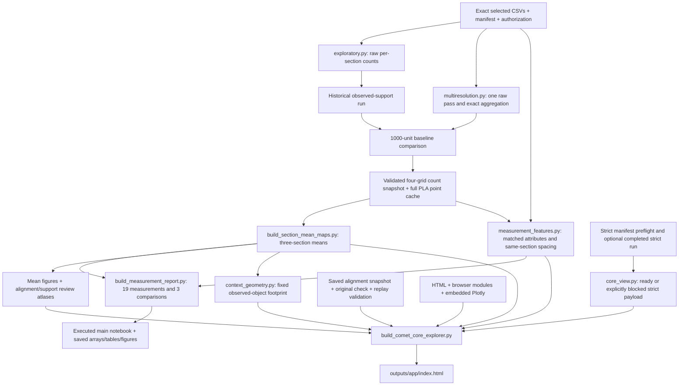
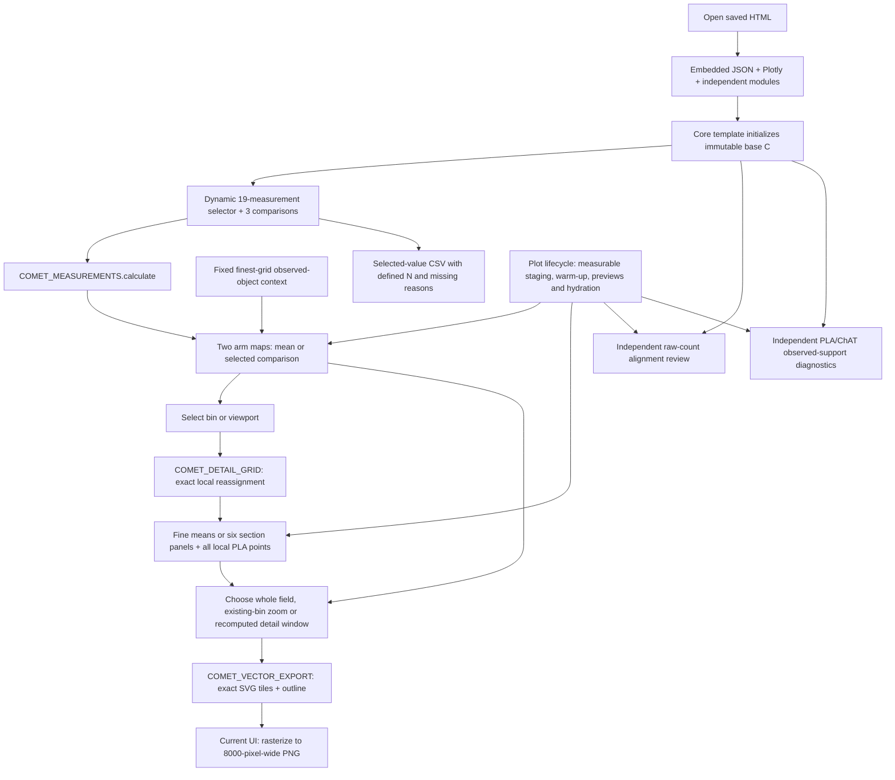

# Code reference: from source exports to the offline Explorer

This appendix describes the source files inspected on 19 November 2026. It covers every Python, JavaScript and HTML source in `scripts/`, and every Python module in `comet_spatial/`. Generated HTML, notebooks and numerical snapshots are outputs or evidence; edit their builders when changing the implementation. File links below open the source rather than the large built app.

The project has several generations of analysis. The current report uses twelve selected completed sections, the saved transforms, the agreed three-section empty-count-bin rule, nineteen spatial measurements, three condition comparisons and finer local exploration. Earlier native-export exploration, the older observed-support denominator and the original strict tissue-mask contract remain separately auditable. A historical script or saved document can correctly describe its own stage while disagreeing with the current analysis.

## 1. The execution boundaries

| Operation | Runs where | Inputs needed | What it changes |
|---|---|---|---|
| Open `outputs/app/index.html` | Browser, offline | The one saved HTML file | Browser state and requested downloads; no repository files or raw CSVs |
| Change measurement, comparison or detail width | Browser | Embedded counts, full PLA points and matched attributes | Recomputes selected section/bin statistics in memory; preserves source coordinates and saved baseline |
| Rebuild the app | Python | Saved payloads, feature cache, templates and Plotly | Replaces the assembled HTML and context-geometry presentation artifact |
| Derive the current report from saved counts | Python/Jupyter | Validated multiresolution predecessor and matching features | Creates new dated calculation/mean runs, figures and tables; updates selected-run pointers |
| Recount raw exports | Python | The exact source CSVs, manifest and authorization | Creates a new validated exploratory counting snapshot |
| Run the strict PDF method | Python | Its own complete accepted-input manifest, centroids and existing masks | Produces a separate strict numerical run if preflight passes |

Opening the standalone app requires neither Python nor the raw files. Python is needed to regenerate notebook outputs or repository artifacts. Node.js is needed for the independent Python/browser engine comparison, not for ordinary viewing.

All `scripts/*.py` files have an `if __name__ == '__main__'` entry point. Importing a script defines its functions rather than invoking that entry point. Several imports set local cache paths or the noninteractive Matplotlib backend; that is different from executing the analysis. Package modules are imported infrastructure; `native_atlas.py` additionally exposes a CLI.

## 2. Current build and evidence flow

[Open this flow diagram as scalable SVG](diagrams/code_reference_flow_1.svg)

The strict branch does not invent masks or replace the later authorized exploratory policy. A blocked strict payload can coexist with a ready current Explorer. A `latest_run.json` file selects a dated snapshot; it is not itself the scientific result. Portable loaders generally prefer the matching copied run directory inside this checkout before falling back to a recorded absolute path.

## 3. Current Python orchestration and report scripts

### [build_current_notebook.py](../../scripts/build_current_notebook.py)

`build()` writes the current source of `TDP43_COMET_analysis.ipynb`; `measurement_cells()` supplies its calculation-functions explanation and executable report cell. The first analysis cell calls `build_section_mean_maps`, mean-figure and review-figure builders. With `TDP43_RECOUNT_RAW=1`, it first calls the exploratory and multiresolution raw counting functions. Otherwise it reuses validated saved counts.

Later cells independently check means, differences, support and point totals, inspect preserved alignment evidence, call `build_measurement_report`, rebuild the app through `build_comet_core_report`, and update `outputs/validation.json`. The generated notebook currently has eight nonempty code cells. Source generation clears saved execution outputs; execution is a separate step. The generated cells assume repository-root execution and existing predecessor/policy artifacts.

### [build_notebook.py](../../scripts/build_notebook.py)

The public `build()` now delegates to `build_current_notebook.build()`. Running this script therefore generates the current main report. Its explicitly named `build_historical_observed_support_report()` retains the older notebook generator, including its variable observed-section denominator, raw recount, historical sensitivities and original strict-pending language. Calling that historical helper directly would overwrite the same main notebook with the older report.

`review_cells()` returns a self-contained cached-data presentation section used by the historical refresh utility. Keeping that helper available does not make its historical headings or scientific wording current authority.

### [execute_notebook.py](../../scripts/execute_notebook.py)

`main()` reads the chosen notebook, defaults to the main notebook, and creates a temporary kernelspec whose executable is `sys.executable`. `NotebookClient` executes with a 600-second per-cell timeout from the repository root. It checks that every nonempty code cell received an execution count, rejects error outputs and validates the notebook structure before replacing the notebook through a temporary file.

If present, `outputs/validation.json` receives execution counts and the number of saved PNG outputs. Notebook replacement is guarded; files written by earlier successfully executed cells are not transactionally rolled back if a later cell fails.

### [build_section_mean_maps.py](../../scripts/build_section_mean_maps.py)

`locate_run()` resolves a selected run using a local-copy preference. `build()` reads the validated `exploratory_multiresolution` snapshot and the explicit three-section/zero policy, deep-copies the payload, then calls `summarize_section_means()` separately at all four widths. It independently verifies count sums divided by three and Running minus Homecage.

It retains full-grid arithmetic separately from display-masked values, preserves point coordinates/transforms, saves per-arm NPZ matrices and bin CSVs, and creates a dated `outputs/section_means/` run with source/code/policy hashes. It refuses incomplete predecessor validation or a changed predecessor and updates `latest_run.json` only after the derivation. It does not reread CSVs.

### [build_section_mean_figures.py](../../scripts/build_section_mean_figures.py)

`build()` requires a validated fixed-three run. Nested `decorate()`, `header()` and `save()` helpers construct separate 250- and 100-unit difference panels and means-plus-difference layouts. Full-range and explicitly saturated contrast versions accompany each other. Means share a sequential range; differences share a symmetric range across arms.

Outputs are 600-DPI PNGs, SVGs and `detailed_figure_manifest.json` inside the selected mean run, including pixel dimensions and PNG hashes. Its `pcolormesh(..., rasterized=True)` means these older SVG heatmap layers contain raster content. They are distinct from the newer all-vector measurement exports.

### [build_measurement_features.py](../../scripts/build_measurement_features.py)

This small executable wrapper calls `measurement_features.build_feature_cache(ROOT)`. It extracts attributes from the exact selected CSVs, matched to the established object cache, without changing the spatial analysis. It is the explicit raw-input step when no usable attribute cache exists. The extraction and validation behavior belongs to the package module described below; this wrapper adds no alternative scientific rule.

### [build_measurement_report.py](../../scripts/build_measurement_report.py)

`build(root, area_cutoff=.1, marker='chat')` requires the current fixed-three predecessor, obtains the validated feature cache and evaluates all nineteen measurements at 1,000/500/250/100 units. For each arm it computes all three comparisons, retaining section values, defined masks, condition means, measurement-specific N, eligibility and missing reasons in compressed arrays. `summary.csv` has one row per resolution/measurement/comparison/arm.

It verifies unchanged PLA-count baselines, large-plus-small count conservation and marker-subset containment, then records hashes, policies and validation in a dated `outputs/calculation_functions/` run. `save_figure()` makes eleven representative two-arm comparisons and their display-contrast companions: twenty-two figure pairs. It draws exact finite tiles with non-rasterized `PolyCollection`, context strips and boundary `LineCollection`; the colorbar is also kept vector. The shared 95th-percentile contrast cap changes color display only. Source bytes must remain unchanged before the selected-run pointer is written.

### [build_review_figures.py](../../scripts/build_review_figures.py)

`build()` prefers the current section-mean run and falls back to the earlier multiresolution run. It checks conservation, unchanged transforms and the full unsampled PLA cache. It creates a categorical four-panel observed-support figure and a six-section all-PLA atlas for each arm under `outputs/comet_core/detailed_review/`.

Nested `axes()`, `frame()` and `save()` preserve shared framing, clear scientific captions, 600-DPI PNG dimensions and a source-payload hash manifest. These are presentation outputs from saved measurements, not new registrations. Its SVG points/support layers are explicitly rasterized; the download does not promise all-vector object clouds.

### [build_comet_workflow.py](../../scripts/build_comet_workflow.py)

`build()` draws the current experiment-to-results overview with Matplotlib boxes and arrows and replaces `outputs/figures/workflow.png` and `.svg` at 600 DPI. Its diagram explains the baseline raw-count three-section policy and the three visual families. It is a presentation summary, not an executable calculation specification for every intensive measurement. No CSVs or measurements are processed.

### [build_comet_core_report.py](../../scripts/build_comet_core_report.py)

`build(root, run_directory=None)` rebuilds the workflow figure, runs strict `preflight_manifest`, writes `outputs/preflight.json`, and calls `build_core_view_payload`. When strict inputs are missing, it can present the manifest's concise pending-input explanations while preserving detailed diagnostics on disk. It writes `outputs/core_view/payload.json`, then calls the main app builder.

The CLI `--run` explicitly selects a completed strict run; it does not automatically turn a current exploratory run into strict results. The returned current app status and strict status are separate fields.

### [build_comet_core_explorer.py](../../scripts/build_comet_core_explorer.py)

This is the current standalone-app assembler. `load_exploratory()` checks the historical exploratory status and required validation flags. `load_multiresolution()` prefers `outputs/section_means/latest_run.json`, requires exactly the four recorded resolutions and validates complete unsampled point-vector lengths and total count.

`build()` loads the strict payload or a blocked substitute, saved alignment audit, selected cohort and scientist questions. It checks original alignment-image SHA-256, only asserts verified replay when the image/hash/validation evidence agrees, and verifies the twelve-section source matches. It loads or immutably extends matched attributes, records the actual feature-payload hash separately from the predecessor-count hash, derives fixed context geometry and only embeds review figures whose source hash matches the selected spatial payload.

It embeds JSON, Plotly, templates and browser modules into `outputs/app/index.html`; JSON `<` characters are escaped before insertion. Missing optional evidence produces an unavailable or blocked display rather than fabricated maps. Invalid existing hashes or incomplete numerical validation raise errors. This builder does not recount source CSVs, but extending an older validated feature cache can create a new nearest-neighbor cache and update its pointer.

### [build_repository_appendix.py](../../scripts/build_repository_appendix.py)

This documentation utility does not execute analysis or modify source data. `paths_for()` asks Git for tracked and deliberately selected untracked project files; a ZIP can fall back to the published inventory. `describe()` associates each path with an explicit purpose, `symbols()` lists named Python/JavaScript entry points, and format readers record CSV columns, NPZ array names, PNG dimensions and saved notebook structure. Generated figures and repeated result runs receive individual catalog entries rather than being treated as extra code or animals.

`render_catalog()` writes the human-readable file index; `workflow_svg()` draws its scalable end-to-end process diagram. `check_links()` checks relative documentation targets and balanced code fences. `build(..., check=True)` verifies that every selected path still appears in the catalog. Adding files or changing methods requires updating the relevant prose and regenerating the inventory. This is coverage/documentation validation, not an independent validation of the science.

## 4. Raw-data, strict-method and provenance utilities

### [configure_local_inputs.py](../../scripts/configure_local_inputs.py)

`configure()` changes only local source paths in `metadata/analysis_manifest.json`. `digest()` hashes every recorded source. Before any replacement it verifies cohort authority, thirteen distinct exports, twelve retained sections, the 4978-to-5403 supersession, matching source IDs and every expected CSV hash. Raw files are neither copied nor edited.

`--check-only` performs verification without changing configuration. A temporary file, `fsync`, concurrent-edit byte check and atomic replacement protect the manifest. `main()` reports clear failures with exit code 2. This is unnecessary merely to view the saved app.

### [inventory_data.py](../../scripts/inventory_data.py)

`main()` scans an explicitly supplied data folder and optional reference folders. `audit_csv()` streams rows, profiles every column, preserves literal classes/labels, checks bounding boxes and duplicate IDs, and optionally retains exact and measurement signatures. `signature()` uses length-prefixed exported strings with BLAKE2b; measurement overlap excludes `Analysis Region` and `Object Id`. `profile_value()`, `infer_type()` and `dictionary_entry()` explain observed types, missingness, ranges and units.

Outputs include input manifests, data dictionaries, file/column audits, overlap tables, validation and an inventory report. Existing curated `sample_metadata.csv` is preserved; refreshed suggestions go to an observed-metadata file. Hashes are checked before/after scans. Malformed rows are counted in the audit, not quietly accepted by analysis. File identity or repeated measurement strings never approve biological identity. Some generated blocker text records the original intake stage and can predate later cohort authorization.

### [extract_alignment_snapshot.py](../../scripts/extract_alignment_snapshot.py)

`extract()` reads the former app's precisely identified embedded JSON marker, compares each saved proposal with its separate proposal JSON, reconstructs the recorded reflection/translation matrices and recovers cell edges from saved centers. It checks matching app/NPZ counts and occupancy, hashes current inventory copies and records the former Git revision when available.

It writes `alignment_snapshot.json` plus an updated `asset_audit.json`. `asset()` and `sha256()` bind files to hashes and sizes. It requires the expected twelve-section historical snapshot and stops when the payload marker or paired records disagree. This is extraction of existing evidence, not fitting or anatomical approval. Its historical revision labels describe extraction provenance.

### [reproduce_alignment_check.py](../../scripts/reproduce_alignment_check.py)

`build()` compares the direct saved center/flip formula with every recorded affine matrix, copies or verifies the unchanged original reference, and calls the frozen `alignment_figure()` renderer. It exports reproduced PNG/SVG images and `alignment_replay_validation.json`, including renderer/library versions and an exact pixel comparison.

Changed source bytes or missing original evidence stop replay. Different rendering libraries/fonts can alter pixels without altering geometry; numerical transform checks and pixel checks are distinct. The script updates scope wording if the selected-cohort authority exists. It never promotes an old proposed-status record into anatomical approval.

### [run_exploratory_maps.py](../../scripts/run_exploratory_maps.py)

`main()` supplies manifest, authorization and output paths to `exploratory.run_exploratory_maps()`. It reports blocked source/metadata failures with exit code 2. Its output is the original authorized object-support counting family, not today's fixed-three mean derivation. Running it can be useful for a full raw recount, but its saved support-denominator means remain historical predecessors.

### [build_multiresolution_maps.py](../../scripts/build_multiresolution_maps.py)

`main()` calls `multiresolution.build_multiresolution_maps()` with explicit manifest/authorization/output paths and an optional baseline run. By default it resolves a selected earlier exploratory run for the 1,000-unit comparison. It reports errors without claiming strict results. The package performs the single raw pass, exact aggregation and full-point provenance; this wrapper provides the CLI.

### [build_exploratory_figures.py](../../scripts/build_exploratory_figures.py)

`build(run_directory)` renders the earlier single-grid observed-support means and differences, categorical N, all-three-observed display sensitivity and condition means. Helpers `diff()`, `support()`, `axes()`, `frame()` and `export()` preserve scales and captions. It saves 300-DPI figures, `findings.json`, a figure manifest and extreme-bin native-coordinate review windows obtained by inverse fixed transforms.

It requires explicit non-strict status. Its old `minimum_observed` filters and denominator descriptions apply to the earlier estimator, not the current fixed-three results. Extreme windows are review selections, not representative samples or statistically validated hotspots.

### [build_detailed_figures.py](../../scripts/build_detailed_figures.py)

`build(run_directory)` reads the historical multiresolution `index.json` and per-resolution payloads. It renders fine comparisons, a labeled ±25 display version, four-resolution sensitivity, condition/support panels and individual-section count atlases, with 300-DPI PNG/SVG exports and a resolution-summary CSV.

Its nested `mesh()` uses exact recorded edges with no interpolation, but sets rasterization for dense SVG layers. It refuses payloads not explicitly exploratory. The saved observed-support means and varying-N explanations are historical; use current mean and measurement report builders for current outputs.

### [run_analysis.py](../../scripts/run_analysis.py)

This is the separate strict-method executable. `main()` runs `preflight_manifest()` first and saves diagnostics. `read_objects()` requires exact declared selection strings, unique headers, explicit PLA classification and finite supplied centroid fields. `load_existing_mask()` accepts existing Polygon/MultiPolygon GeoJSON or raster-cell NPZ geometry and applies the supplied transform without repair/resampling.

`execute()` calls `count_section()`, exact full-bin mask validity and `summarize_by_arm()`, then saves section matrices, all selected object provenance, original mask geometry, arm tables and figures in a staged dated run. `save_matrices()`, `write_objects()`, `orient_axes()` and `export_figures()` provide auditable exports. Input/reference hashes are rechecked before publication. The regenerated mask/centroid inspection is not automatically the original accepted check. Exit 0 means preflight ready, 2 means blocked, and 3 means numerical output completed with scientific alignment comparison still pending.

### [validate_measurement_engines.py](../../scripts/validate_measurement_engines.py)

`validate()` reads selected counts/features without recounting. `NODE_PROGRAM` runs the real JavaScript engine through Node, writing temporary float/boolean binary arrays. Python computes the corresponding section values, masks, means, N and comparisons, checks exact finite/undefined masks and numerical agreement with `atol=rtol=1e-12`, and records array/scalar counts and maximum error.

It covers all nineteen measurements plus an additional large-count cutoff variant at 100 units and checks the PLA baseline at all four resolutions against a specific retained published fixed-three snapshot. `geometry_digest()` and before/after file hashes detect geometry/support/input changes. Missing Node, the required historical snapshot or numerical agreement causes failure. It writes a compact protocol JSON; it does not validate biological interpretation merely because two implementations agree.

## 5. Browser application and interaction flow

[Open this flow diagram as scalable SVG](diagrams/code_reference_flow_2.svg)

### [comet_core_explorer.html](../../scripts/comet_core_explorer.html)

The main HTML/CSS/controller template supplies the three tabs, export controls, explanatory text and fixed placeholders replaced by the builder. It parses embedded `DATA`, selects the finest available default global grid and retains `C` as the baseline count payload. `showTab()`, `available()`, `reasons()` and `requirements()` manage availability without manufacturing unavailable arrays. `mapLayout()` preserves aspect and recorded screen direction; `colorDisplayScale()` creates shared linear display limits and counts saturation without capping values.

`renderDifferences()` delegates current metrics to the measurement-controls module; `renderCoverage()` and `renderAlignment()` allow specialized renderers to replace the saved-data fallbacks. `setUpAlignment()`, `layerControls()`, `nativeGuidePoint()` and `appendSavedGuides()` preserve original section visibility, anchors, cues, source statuses and reference-image evidence. Historical surface/camera fallback code remains in the source, but the current detailed alignment renderer enforces the requested flat two-dimensional view.

For local inspection, `setFocusAt()`, `selectDefaultFocus()` and `focusPointCache()` choose a window and retain every matching cached PLA object. `cropForFocus()` accepts either global or finer local edges. `renderFocus()` displays condition means or six section panels with selected metric bins, defined-section N, exact source-object hover data and the metric-independent footprint. `bindMainZoom()` links numerical viewports; it does not claim common anatomy across arms. `window.COMET_CORE_EXPLORER` exposes state getters and helper/renderer hooks for the companion modules. Changing PNG export size is not a rebinning operation; main map dimensions remain CSS-controlled.

### [comet_measurement_controls.js](../../scripts/comet_measurement_controls.js)

This fragment is embedded inside the core controller after its source globals. `initializeMeasurements()` populates options from the engine's live nineteen-entry catalog rather than relying on thirteen static fallback options. Marker controls are enabled only for exported ChAT; relevant measurements expose the nonnegative area cutoff. `measurementResult()` keeps chosen calculations separate from `C`, checks feature-cache readiness and caches two recent selections. `measurementKey()` includes grid, metric, comparison, cutoff and marker so old statistics cannot be reused for a new selection.

`measurementMeta()`, `metricUnits()` and `applyMeasurementText()` keep active marker/cutoff/empty-bin rules visible; section-share subtraction uses percentage points. `hoverMatrix()` prepares section lookups once per arm and uses a cached number formatter. `validMetricN()` reports sections defining the selected statistic separately from raw observed N. `metricDomainMatrix()` preserves nulls and eligibility; an available one-condition mean remains inspectable even when its comparison is undefined.

`observedFootprintTraces()` adds a pale background before metric tiles and an unsimplified SVG `scatter` boundary after them. Its fixed finest-grid holes and boundary are independent of the selected statistic; no missing values are filled. `detailAnalysis()` calls the local-grid module, caches two requests and selects a coarser listed width with an explicit notice if the window would exceed 400 cells per axis.

`selectedExportOptions()` distinguishes whole field, existing-global-bin zoom and recomputed fine-window data, preserving actual bin width, scientific units and separate feature/count source hashes. `exportMeasurementImage()` uses current `PNG_EXPORT_WIDTH=8000`, serializes exports to one in-flight allocation, reports progress/errors and names PNGs `_8000px` and SVGs `_vector`. `downloadMeasurementTable()` exports exact selected numerical values, bounds, per-section values, measurement N, observed N, missing reasons and policy; nulls become empty CSV fields. The fine-detail navigation button scrolls/focuses controls without changing selections.

### [comet_measurements.js](../../scripts/comet_measurements.js)

This DOM-independent engine exports `COMET_MEASUREMENTS` in browsers and `module.exports` for Node audits. `MEASUREMENTS` defines nineteen functions and their units/cutoff/marker/empty-bin metadata; `COMPARISONS` defines absolute difference, percent change and log2 ratio. `binIndex()` implements internal-edge assignment and the final inclusive maximum; `quantile()` uses type-7 linear interpolation of ordered values, not spatial interpolation.

`prepare()` validates indexed points/features, source hashes and exact agreement of point-bin membership with saved section counts, retaining a small prepared cache. `sectionValues()` calculates per-section statistics using typed arrays and per-bin sorted buckets where needed. Invalid required attributes make dependent metrics undefined instead of silently removing objects. CV uses a centered two-pass population variance and requires at least two values and a positive mean.

`calculate()` validates the grid, cutoff, distinct section IDs and exactly three distinct animal sections per condition/arm. Counts, sums and positive-total section shares have defined empty-bin zeros; intensive measures and fractions require the necessary objects/denominators. It averages defined section values equally, then calls `compareConditions()`. Percent change requires nonzero Homecage mean; log2 requires both means positive; no pseudocount is introduced. Returned means, masks, measurement N, absolute/selected comparisons and missing-reason codes remain distinct from copied display eligibility. The JavaScript implementation is independently checked against the Python engine.

### [comet_detail_grid.js](../../scripts/comet_detail_grid.js)

`COMET_DETAIL_GRID.calculate()` builds a genuinely new local grid from full cached coordinates. `detailGrid()` snaps requested limits to 10/25/50/100-unit edges and rejects invalid or over-400-by-400 shapes. `uniqueBySection()` and `selectedRecord()` reject duplicate identities and misindexed attribute vectors. Every object within the snapped extent contributes once; the visible viewport remains the requested window.

It removes coarse ChAT/support arrays rather than mislabeling them as fine measurements, preserves the original full-section PLA total for section-share normalization and slices already computed same-section nearest-neighbor distances. It never recomputes neighbors using only the ROI. `projectedDomain()` assigns the unchanged 100-unit observed display domain by fine-cell center; that remains uncertain object-based context. The standard engine then computes the selected local statistic. No interpolation or alignment fitting occurs.

### [comet_vector_export.js](../../scripts/comet_vector_export.js)

`svg(options)` validates increasing color limits, matrix/edge shapes and viewport bounds, then draws each defined metric tile as an SVG rectangle. It adds merged context strips, the exact separated boundary path, labels, a colorbar, saturation counts and escaped provenance metadata. Undefined tiles remain absent. `color()` maps numerical values onto the same linear palette. The fixed 2,000-unit SVG viewBox is a scalable document coordinate system, not a 2,000-pixel raster cache.

`download()` saves this true vector document directly for SVG. For PNG it loads the vector document and paints onto a canvas at the requested target dimensions, calls `toBlob()`, downloads the result and releases canvas/object-URL resources in `finally` blocks. Tall canvases over 16,000 pixels and allocation/encoding failures are rejected. The reusable library still accepts programmatic widths 8,000 or 12,000; the current visible UI fixes PNG width at 8,000. Larger output pixels do not change measured bins or add objects. The dedicated export buttons differ from Plotly's ordinary modebar screenshot downloads.

### [comet_plot_lifecycle.js](../../scripts/comet_plot_lifecycle.js)

`createPlotLifecycle(env)` wraps Plotly operations while leaving measurements, colors and coordinates untouched. `withPanel()` temporarily stages hidden tabs offscreen at a measurable width; `dimensions()` rejects zero drawing areas. `render()` serializes per-plot work and uses version counters to discard obsolete renders. `fit()` restores explicit axis ranges after sizing, solving plots that otherwise appear only after a zoom/resize.

`boot()` waits for fonts/images and pending work, eagerly warms alignment and support views, then activates the visible tab. `suspend()` captures a loaded preview and purges inactive WebGL resources; `hydrate()` restores traces, ranges and saved event handlers when the view becomes active. `purgeTree()` cleans plots before controller HTML replacement. `ResizeObserver`, `whenIdle()`, promise tracking and readiness/error messages coordinate later interactions. A hidden preview does not replace source data or imply new analysis; it limits simultaneous browser graphics resources.

### [comet_alignment_detail.js](../../scripts/comet_alignment_detail.js)

Pure geometry helpers include `forwardPoint()`, `inversePoint()`, `binIndex()`, `nativeTileGrid()` and `exactTileMesh()`. They preserve fixed matrices and correctly reverse count/support indices for reflected native rectangles. General rotated native rectangular grids are not falsely represented as axis-aligned tiles.

`joinRows()` links historical snapshot sections to the selected current source identities; `pointCoordinates()` uses original native or saved aligned vectors. `ranges()` crops only the viewport to observed-object extent. `heatTrace()` and `pointTrace()` show exact raw-count context and all selected source points on common ranges, independent of the chosen measurement on the comparison tab.

`detailedAlignment()` schedules rendering through the lifecycle and exposes `app.alignmentReady` for warm-up. `renderAlignmentNow()` forces flat review; `renderDetail()` builds the six-section atlas or a larger single-section ROI. Saved anchors/cues remain unchanged, point hover retains object IDs/source rows/native coordinates, and overlay blending is explicitly not a condition mean. Generation guards avoid stale asynchronous results. Native/saved frame changes display existing geometry and do not fit new registration or invent physical depth.

### [comet_support_detail.js](../../scripts/comet_support_detail.js)

This installs `app.supportRenderer` for the observed-support tab. `nMatrix()` reads the baseline raw PLA/ChAT observed-section arrays; `matrixMembership()` names which sections contain detections and their exact counts. `renderOverview()` draws four categorical N=0/1/2/3 maps or a larger selected-arm pair. `bindOverview()` links numerical viewports with recursion protection.

`setWindow()`, `pointsInWindow()`, `crop()`, `gridShapes()` and `renderDetail()` connect a selected bin to its six-section membership table and every cached PLA midpoint in the surrounding window. Optional raw PLA, raw ChAT and support tiles remain baseline diagnostics, not silently substituted selected metrics. The shared context outline is labeled arm-wide object context rather than an individual section's tissue boundary. Click handlers ignore traces without bin data; cached membership and point slices are invalidated by their relevant resolution/window keys.

## 6. Historical/native presentation files

### [build_native_notebook.py](../../scripts/build_native_notebook.py)

`build()` writes `TDP43_native_supporting_analysis.ipynb`, not the current main notebook. It retains eight-export intake/native reconstruction, morphology, overlap and historical findings. Its generated cells verify source hashes, rebuild the native atlas/findings/report, run a software suite and record native-stage validation.

Executing it can overwrite shared `outputs/validation.json` with that historical scope and invoke broader report builders. Its original unresolved-assignment statements describe the initial eight-file intake, not the subsequently selected twelve-section cohort. Regenerating source clears this supporting notebook's outputs; generation alone does not execute its cells.

### [build_spatial_explorer.py](../../scripts/build_spatial_explorer.py)

`build()` requires a saved native-atlas payload with exports, embeds optional historical PNGs plus inventory/provenance and inserts Plotly into `spatial_explorer.html`. It writes `outputs/app/native_explorer.html` and native display-starting parameters. Raw native counts are already calculated; selected point overlays in this older atlas are deterministic capped display samples. It does not overwrite the main Explorer, infer conditions or supply masks.

### [spatial_explorer.html](../../scripts/spatial_explorer.html)

The supporting native template offers independent-export maps, sampled PLA/ChAT overlays, count/association views, paired-export inspection, morphology distributions, historical context and provenance. `trace()` uses all saved counts and explicit optional log-color transforms; `overlayTraces()` uses separately recorded display samples. `renderAtlas()` optionally makes a measurement-height surface: Z is a bin count, not anatomical depth.

`preparePairs()`/`renderPair()` use recorded overlap evidence for descriptive export comparisons. `bindAtlasEvents()` builds source-bin/object review records; `downloadCSV()` exports those records. `drawFindings()`, `renderHistorical()` and `renderMethods()` keep historical results and original intake provenance visible. This template has its own lazy-tab behavior; the newer core lifecycle module is not implicitly applied to this separate native app.

### [build_report.py](../../scripts/build_report.py)

`build()` reads the original inventory and makes export-count, overlap and strict-contract workflow figures through `save()`. It writes `outputs/app/input_audit.html`, then calls both `build_spatial_explorer()` and `build_comet_core_report()`, so it has broader effects than its name suggests. The latter call restores the current workflow illustration and rebuilds the current main app.

Its initial input-audit page intentionally preserves the blocked intake-stage explanation. Do not read that historical page as the current app's readiness status. Shared workflow files are overwritten during this sequence; this is not a new numerical comparison.

### [build_findings.py](../../scripts/build_findings.py)

`build()` reconciles the original native atlas with audited PLA counts and ChAT flags, then saves export-level signal profiles, high-overlap export-pair sensitivities and morphology-quality figures/tables. Nested `save()` and `q()` helpers export figures and require exact recorded distribution quantiles.

It writes native findings, descriptive parameters and `docs/native_results_guide.md`. Pair selection uses measured-signature overlap for review; it does not establish repeat identity or new group assignments. Diameter-ratio exclusions do not remove objects from count/association denominators. Its eight-export and historical uncertainty statements belong to that supporting analysis.

### [refresh_review_notebook.py](../../scripts/refresh_review_notebook.py)

`main()` imports historical `review_cells()`, executes only their self-contained presentation cell in a temporary same-Python kernel, validates it, and atomically replaces/inserts that two-cell section in the main notebook while retaining other saved cells. It records that raw counts were not rerun.

This is a specialized historical presentation utility. If the section is absent, insertion looks for the old `## Strict PDF results` heading; the current generated notebook uses a different structure, so that fallback can fail rather than guessing a location. Prefer the current generator/executor for structural current-report changes.

### [serve_app.py](../../scripts/serve_app.py)

`app_directory()` finds the saved app independent of the shell's working directory. `main()` starts a standard-library `ThreadingHTTPServer` bound only to `127.0.0.1`, normally port 8050, and optionally opens the browser. `port_number()` validates the argument. `AppRequestHandler.send_head()` prevents symlink escapes outside `outputs/app`; directory listing is disabled.

Missing app files and occupied ports produce actionable messages. This launcher serves saved artifacts only; it does not recompute data and needs no scientific Python dependencies.

## 7. Python calculation package: file-by-file map

| Module | Main constructs and responsibility | Inputs, outputs and guards |
|---|---|---|
| [__init__.py](../../comet_spatial/__init__.py) | Package description and version `0.1.0`. | No experiment execution, file loading or fabricated fallback results. |
| [core.py](../../comet_spatial/core.py) | `GridSpec` fixes increasing edges and matrix order; `FixedTransform` applies supplied affine geometry; `assign_centroid_bins()`/`count_section()` count unique objects; `polygon_tissue_validity()` and `raster_cell_footprints()` retain exact supplied masks; `SectionResult`, `SectionCounts`, `ArmSummary`, `summarize_by_arm()` and `shared_symmetric_limit()` implement the strict branch. | Uses [y,x] arrays, final-edge inclusion and exact whole-bin `covers`; rejects duplicate object IDs, invalid geometry/counts/transforms. Valid zeros enter mask-valid section means; missing coverage stays missing. No fitting, buffered masks or object-level inference. |
| [manifest.py](../../comet_spatial/manifest.py) | `empty_manifest()`/`section_template()` create blocked intake schemas; `load_manifest()`, `grid_from_manifest()`, `display_directions_from_manifest()`, `validate_manifest()` and `preflight_manifest()` check documentary authority and assets. | Hashes sources, masks, alignment reference and relationships; requires explicit selection/position/acceptance/display metadata. Anatomical words do not imply screen flips. A ready schema is internal/documentary validation, not independent anatomical proof. |
| [core_view.py](../../comet_spatial/core_view.py) | `build_core_view_payload()` verifies a selected strict run; `_load_arrays()`, `_provenance_preview()`, `_mask_geometry()` and `_alignment_geometry()` reconstruct portable evidence; `_blocked()` provides explicit empty unavailable views. | `_run_file()` confines artifacts to the selected run. Every saved object contributes to validation; only strict preview points may be capped. A blocked current preflight takes precedence over stale strict results. The current full-PLA Explorer cache comes from another branch. |
| [exploratory.py](../../comet_spatial/exploratory.py) | `count_raw_section()` reads every selected PLA/ChAT object, derives the explicitly authorized bounding-box midpoint and writes full PLA provenance; `summarize_observed_sections()` implements the older observed-support estimator; `run_exploratory_maps()` stages and publishes a validated run. | Requires authorization, fixed transforms and known literal classes. ChAT-only support contributes PLA=0; empty unsupported section-bins were omitted in this historical mean. Checks counts and source/transform hashes before publishing. It never provides strict tissue validity. |
| [multiresolution.py](../../comet_spatial/multiresolution.py) | `grid_at_width()`, `aggregate_counts()`, `refinement_checks()` and `build_multiresolution_maps()` produce genuine four-grid counts. `_read_pla_points()` retains complete object vectors; `_compare_baseline()` verifies the earlier 1,000-unit result; `support_statistics()` describes support. | One raw pass uses an internal greatest-common-divisor grid for exact integer aggregation. Recomputes support/means after counts rather than averaging old maps. Both 250 and 100 divide 500; they are not nested in each other. Counts, extents, hashes and full point total are checked. |
| [section_means.py](../../comet_spatial/section_means.py) | `summarize_section_means()` implements an explicit fixed denominator and returns means, sums, differences, observed N, assumed-zero N and display masks. | Validates common finite nonnegative integer count shapes, identities, physical-section/arm uniqueness, animal condition consistency and three distinct animals per group. `zero` is the current agreed policy. Optional `missing` keeps denominator fixed and requires full observed support; it never reweights the available subset. |
| [measurement_features.py](../../comet_spatial/measurement_features.py) | `extract_section_features()`, `point_order_hash()`, `feature_number()`, `build_feature_cache()`, `load_feature_cache()` and `ensure_spatial_feature_cache()` bind attributes to existing ordered objects. `nearest_neighbor_distances()` and `spatial_feature_policy()` describe exact same-section spacing. | Verifies source SHA, ID, source-row and native/aligned coordinates, vector lengths and feature-payload hash. Invalid attributes remain null. `cKDTree.query(k=2, eps=0)` excludes self; distinct coincident objects may have zero distance. Singleton spacing is undefined. Old valid caches can be extended immutably without rereading CSVs. Missing cache returns unavailable; it is not invented. |
| [measurements.py](../../comet_spatial/measurements.py) | Python `MEASUREMENTS`/`COMPARISONS`, `_section_values()`, `_bins()`, `compute_measurement()` and `compare_conditions()` mirror the browser's section/bin calculations and missing-value rules. | Accepts a selected resolution plus points or a combined payload. Retains supplied eligibility, equal section weighting, formula units and missing reasons. It does not modify input arrays, pool arms or add pseudocounts. Engine parity checks implementation agreement, not biological truth. |
| [context_geometry.py](../../comet_spatial/context_geometry.py) | `footprint_geometry()` detects horizontal/vertical occupied-grid transitions and merges collinear runs; `build_context_geometry()` uses the finest available recorded display mask independently per arm. | Verifies finite increasing edges and matching shapes, preserves gaps/holes, returns separated SVG-ready segments, mask and geometry hash. No closing, hole filling or smoothing. Missing/partial input geometry returns no context rather than invented tissue. |
| [alignment_replay.py](../../comet_spatial/alignment_replay.py) | Frozen `boundary_points()`, `transform_xy()`, `style()` and `alignment_figure()` reproduce the former six-panel display. | Historical `boundary_points()` performs one-bin closing and largest-component selection because the original figure did so. This is confined to exact historical display replay; it is not the current unsmoothed context geometry, tissue validity or a registration fitter. |
| [native_atlas.py](../../comet_spatial/native_atlas.py) | `midpoint_coordinates()`, `native_edges()`, `raw_grid()`, `export_payload()`, `morphology_summary()` and `distribution()` build independent-export reconstructions; `sampled_indices()` controls deterministic overlays; `duplicate_review()`, `source_review_targets()` and `morphology_object_review_targets()` record follow-up targets; `build()`/`main()` orchestrate the supporting branch. | All eligible rows enter count maps; capped point displays are labeled separately. Invalid boxes stop processing. Recorded inventory hashes are reused; current source sizes/row counts and count conservation are checked. It does not infer animal/condition identity, registration or tissue masks. Extreme selections can overlap and are not prevalence estimates. |

## 8. Change and rerun order

For a presentation-only current app change, edit the appropriate source template/module, run relevant checks, then invoke `build_comet_core_explorer.build()`. Existing valid cached measurements can be embedded without a raw recount. Test the resulting HTML in a browser because a syntactically correct module does not guarantee visible charts, loaded tabs or correct downloads.

For a current scientific report change, regenerate with `build_current_notebook.py` or the delegating `build_notebook.py`, then execute through `execute_notebook.py`. That execution derives current mean and measurement snapshots, regenerates figures and rebuilds the app. Retain the previous notebook if its saved outputs must remain independently reviewable. Raw recount is optional only when the validated predecessor is intentionally reused; missing first-time feature extraction still requires raw inputs.

For a new or relocated raw source folder, verify/configure paths before recounting. Resolve source identities through the recorded cohort, not filename guesses. The fixed transforms and section assignments must remain explicit inputs. Rebuild the current mean/report/app after a successful new counting snapshot so a new source pointer is not confused with stale downstream products.

The following overwrite boundaries deserve attention:

- `outputs/app/index.html` is rebuilt by the core Explorer builder, including when reached indirectly through `build_comet_core_report` or `build_report`.
- Current and explicitly invoked historical main-notebook generators share the main notebook destination. The native generator uses a separate supporting notebook, but executing that notebook writes shared validation/report artifacts.
- Workflow figures and several manifests are presentation outputs replaced by their builders. Dated numerical run directories preserve preceding calculations, while `latest_run.json` intentionally changes the selected run.
- `refresh_review_notebook.py` is a narrow historical utility, not a replacement for current structural regeneration and full execution validation.

The reproducibility chain is source identity → recorded policy/transforms → section/bin values → condition means → comparison → display/export. A color cap, viewport crop, loaded preview or larger PNG changes presentation. A measurement choice, denominator policy or computed bin width changes the numerical question and must retain its own metadata and validation.
