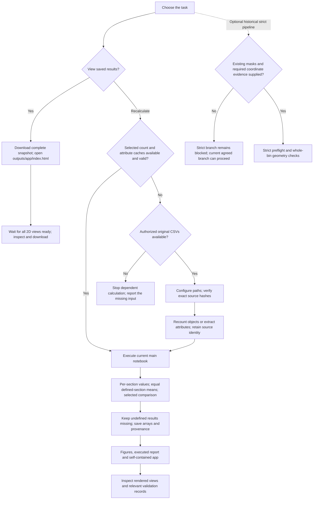

# Repository guide: reports, records and checks

This guide explains the reports, configuration, metadata, documentation and tests behind the COMET Explorer. It describes the working project reviewed on **19 November 2026**. It does not add experimental findings or change the analysis. Use the [file catalog](file_catalog.md) to locate individual generated artifacts, [calculation guide](calculations.md) for the mathematical route from objects to maps, and [code reference](code_reference.md) for implementation details.

To view results, start with the [root README](../../README.md) and open `outputs/app/index.html` locally. To understand a figure, start with [the results guide](../results_guide.md). To recalculate the current study, use the main notebook and selected caches. The supporting native notebook, incomplete intake templates and strict-mask preflight describe different historical scopes; they do not replace the current analysis.

## Which instructions govern the current work?

The independent biological unit is the **animal**: Homecage 21F, 23M and 24M; Running 22F, 21M and 22M. Each animal contributes a different section to HK1 and PFKP. There are twelve completed sections, three per condition within each arm, with the same six animals across arms. Millions of detections and thousands of spatial bins do not increase that biological sample size.

| Record or date | What it establishes | How to read older statements |
|---|---|---|
| Original two-page instruction PDF | Separate HK1/PFKP differences, unchanged alignment, shared grids and explicit denominators. Its strict method also requires whole-bin tissue-mask containment and measured centroids or a documented amendment. | This remains a separate specification. The project has not passed its strict tissue-mask test. |
| 11 November cohort selection and exploratory authorization | The user selected the former app's twelve-section cohort and unchanged alignment, supplied matching expanded CSVs, and accepted labeled midpoint/object-support exploration. | Earlier uncertainty about which cohort or numerical transforms to use was resolved. Initial eight-export assignments are not the current roster. |
| **14 November scientist/user clarification** | Average all three section counts, assume empty section-bins are zero, retain uncertain coverage, reuse the alignment and present 2D views. Images, outlines, scale bars and serial 3D construction are not prerequisites. | Old requests for these assets must not become new gates on the agreed mask-free analysis. Observed-support N no longer determines the count mean denominator. |
| **17 November calculation-functions PDF** | Thirteen per-section measurements and three comparisons, calculated in that order: section measurement, condition mean, then comparison. Required-object statistics remain missing without objects; undefined ratios receive no pseudocount. | Its reference to retaining existing masks does not create masks that the actual project lacks. The documented current coverage convention remains explicit. |
| **19 November extensions and presentation refinements** | Six additional measurements, fixed observed-object context, exact finer local bins and vector exports. The current PNG download width is fixed at 8,000 pixels. | An earlier 12,000-pixel option belongs to a previous presentation revision. Export pixels do not change calculated bin width. |

Read authority by **scope and recorded decisions**, not by a filename, a `pending` string in an old template, or modification time alone. The current default remains signed Running minus Homecage PLA count. Counts and sums include assumed empty-bin zeros; intensive measurements average their defined section values and expose their own N. None of these conventions independently validates anatomy, tissue coverage, assay specificity or acquisition equivalence.

## Viewing, rerunning and validation boundaries

[Open this flow diagram as scalable SVG](diagrams/repository_guide_flow_1.svg)

Opening the app needs no Python, raw CSVs or internet. The optional launcher serves only the app folder on `127.0.0.1`; it does not rerun measurements or expose raw-data folders. Selecting a measurement in the app uses embedded attributes. Fine detail reassigns actual saved points to local bins; it is a calculation, rather than enlarging or smoothing a screenshot.

A cached notebook rerun needs the selected count snapshot and attribute cache, including their hashes and ordered object identities. The report/app can extend an older complete attribute cache with exact same-section nearest-neighbor distances, saving a new immutable descendant. A count matrix alone cannot recover area, intensity or marker flags. A raw recount additionally needs the authorized CSVs, with exact recorded identities; the relocation utility checks hashes before changing paths.

Validation stops dependent work when sources change, identities or vector lengths disagree, coordinates are invalid, a required cache is unavailable, or repeated sections would inflate replication. Failed or unfinished work must not be advertised as a new completed numerical snapshot. The notebook executor saves its executed notebook only after successful execution. A software test using fictional data demonstrates software behavior; it does not turn a missing tissue mask into valid coverage or approve anatomical alignment.

The optional strict branch has additional requirements of its own. Its blocked status is honest and preserved. It does **not** block the scientist-authorized current branch, nor justify silently changing an old manifest to claim nonexistent masks or measured centroids.

## Root files and local-only inputs

Each entry names a separate file. Paths are relative to the repository root unless stated otherwise.

| File | Purpose and how to use it |
|---|---|
| [README.md](../../README.md) | The practical entrance: download/open instructions, Mac shortcut, optional local server, viewing versus recalculation, Python setup and source relocation. It explains the current nineteen-measurement scope and points to authoritative policies. GitHub's HTML preview is not the running app. |
| [TDP43_COMET_analysis.ipynb](../../TDP43_COMET_analysis.ipynb) | The current scientific report. Its code loads validated counts, optionally recounts raw sources, derives fixed-three means, independently checks arithmetic and conservation, verifies the frozen alignment, builds the added measurement report and rebuilds the app. Its explanatory cells separate evidence, limits and next inspection. View saved outputs without Run All. |
| [TDP43_native_supporting_analysis.ipynb](../../TDP43_native_supporting_analysis.ipynb) | The preserved initial eight-export report: native maps, sampled class-balanced overlays, overlapping-export comparisons, morphology review and historical findings. Its older unresolved-assignment and strict-mask statements are historical. Running it needs those raw inputs and writes shared report/preflight/validation artifacts; use the current main notebook for the active rerun. |
| [Launch_COMET_Explorer.command](../../Launch_COMET_Explorer.command) | Mac double-click shortcut. It locates its own project folder, prefers its virtual-environment Python, otherwise uses `python3`, and starts the local app server. Without Python, it can open the saved HTML directly. It is a viewer convenience, not an analysis script. |
| [pyproject.toml](../../pyproject.toml) | Python package/build configuration: project name, version, Python 3.12 minimum, discovered `comet_spatial` package and core versus report dependencies. It allows standard Python packaging; it does not store sample assignments, experimental parameters or measurement results. |
| [requirements.txt](../../requirements.txt) | Compatible version ranges for the analysis/report libraries. Useful when a platform needs alternatives to the recorded environment, but compatible ranges permit different installed versions. They should not be mistaken for a guarantee of identical rendering on every machine. |
| [requirements-lock.txt](../../requirements-lock.txt) | Exact recorded versions, including indirect dependencies and a Mac-specific conditional package. This is the preferred installation route for reproducing the tested environment. These packages are needed for rerunning, not for opening the self-contained app. |
| [.gitignore](../../.gitignore) | Excludes raw folders, instruction PDFs, environments, temporary files and most unselected output runs. Explicit exceptions select reviewable result snapshots for Git. An ignored file can still exist locally; ignoring a filename does not retroactively remove a file already tracked in history. |
| [.gitattributes](../../.gitattributes) | Defines text/binary handling, normalizes script/document line endings, preserves CSV byte behavior and marks generated outputs as generated for repository presentation. PNG, NPZ and compressed artifacts are binary; this configuration does not transform their scientific values. |
| `.DS_Store` | Mac Finder view settings. A previously tracked instance is incidental filesystem metadata, not a scientific input, analysis parameter or result. Its presence has no interpretive role, and its contents are unnecessary for reviewing the experiment. |
| `COMET_Spatial_PLA_Heatmap_Codex_Instructions.pdf` | Local-only original two-page instructions, identified by `instruction_provenance.json`. Requirements and page references are documented in the project; the PDF is excluded from Git. It specifies desired outputs rather than supplying the referenced numerical transforms or tissue masks. |
| `COMET_Spatial_Heatmap_Functions.pdf` | Local-only one-page source of the original thirteen measurement functions and three comparisons. Its fingerprint and page review are recorded in `calculation_functions_policy.json`. The six later additions are explicitly separate; a fresh clone is not assumed to contain either PDF. |

The local source locations include `/Users/adambrewer/Desktop/Coding/TDP43_Analysis/Initial Data/` for the eight-export intake and `/Users/adambrewer/Desktop/Coding/TDP43_Analysis/entire Chat dataset/` for the expanded cohort. Both are excluded from Git. The latter has thirteen exports, but interrupted job 4978 is audit-only and replaced by completed 5403; twelve enter the current analysis. This guide records their roles and locations, not a claim that these folders have been copied into another checkout.

The historical project at `/Users/adambrewer/Desktop/Coding/Bio_Data_Analysis/` remains a separate reference. Its handoff, raw folders and previous conversations are not automatically supplied by cloning this repository. Generic `data/`, microscopy `*.ome.tif`/`*.ome.tiff`, `.venv/`, `tmp/`, Python bytecode and notebook checkpoints are also excluded locally. A source-image path written inside a CSV does not mean that microscope pixels are available. `.git/` contains version-history machinery, not raw experimental observations; credentials and unrelated private configuration are not analysis inputs.

## Metadata: one file, one role

Metadata describe how observations relate to sources and decisions. Their status is scoped: an old template can be incomplete while a later selected-cohort file is complete. Do not merge these records indiscriminately.

| File | Contents, authority and limitations |
|---|---|
| [cohort_selection.json](../../metadata/cohort_selection.json) | Current twelve-section selection authority: animal/condition/arm relationships, thirteen raw hashes, historical source chain, twelve primary jobs and interrupted/replacement relationship. Its older strict-map unresolved-input text is retained provenance; the selected roster itself is resolved and later coverage policy governs current calculations. |
| [selected_section_metadata.csv](../../metadata/selected_section_metadata.csv) | The convenient current twelve-row roster. Each row connects section, physical section, animal, condition, arm, job, source filename/hash, exported region, saved center/reflection and reference job. Use this to join current section outputs, rather than the older eight-row sample template. |
| [scientist_directed_mean_policy.json](../../metadata/scientist_directed_mean_policy.json) | The 14 November authority for fixed-three count averaging, explicit assumed zeros and uncertain coverage. It records reuse of saved alignment, the per-arm observed-domain convention and waived image/outline/scale-bar/3D prerequisites. It explicitly says the historical strict-mask test has not passed. |
| [calculation_functions_policy.json](../../metadata/calculation_functions_policy.json) | Original PDF identity and page, nineteen measurement definitions, original thirteen count, extension reference, comparison formulas, threshold/marker defaults, units and missingness. It distinguishes measurement-defined N from observed support, requires equal section weights and records no pseudocount. The catalog date and extension date have different roles. |
| [spatial_extensions_policy_2026-11-19.json](../../metadata/spatial_extensions_policy_2026-11-19.json) | Definitions and caveats for the six additions, including full-section share denominators, population CV and same-section nearest neighbors. It records fixed context geometry, local rebinning limits, export lineage and technical references. Read presentation refinements with current README/export settings; they do not alter metric definitions. |
| [detailed_visual_parameters.json](../../metadata/detailed_visual_parameters.json) | Current presentation settings: global grids, default 100-unit field, nineteen measurements, linear shared scales, disclosed display caps, all-point context, fine local grids, footprint geometry and current fixed 8,000-pixel PNG behavior. Display caps change color saturation, not saved numerical values or biological inclusion. |
| [alignment_support_review_parameters.json](../../metadata/alignment_support_review_parameters.json) | Dated alignment/support presentation record: fixed snapshot and reference-image hashes, discrete support colors, all 310,024 PLA positions, midpoint definition and 2D interpretation. Its notebook-refresh wording describes that revision, rather than a perpetual execution count for every later notebook. |
| [exploratory_authorization.json](../../metadata/exploratory_authorization.json) | The 11 November authorization to create labeled midpoint/object-support maps while retaining strict results separately. It establishes that exploration was permitted without inventing masks. The later 14 November denominator amendment supersedes the early observed-support averaging method, not the source provenance. |
| [environment.json](../../metadata/environment.json) | Recorded Python executable/version, platform and package versions for analysis execution. It separately points to the historical rendering environment used to reproduce alignment pixels. Machine-specific paths document provenance; another computer should create its own environment from dependencies, not imitate those absolute executable paths. |
| [analysis_manifest.json](../../metadata/analysis_manifest.json) | Structured inputs for the historical strict pipeline and current source-reading foundation: study design, confirmations, shared grid, source relationships, section objects, source hashes, transforms and unresolved strict inputs. False mask/centroid confirmations remain truthful. Do not interpret its strict blockers as a veto of the later mask-free policy. |
| [instruction_provenance.json](../../metadata/instruction_provenance.json) | Original PDF filename/path, SHA-256, size, page count, review date and inspection notes. It records that no embedded masks, transforms or experimental sample table were supplied in that document. This identifies the instructions; it does not itself supply scientific data. |
| [background_provenance.json](../../metadata/background_provenance.json) | The dated 9 November historical review: local and remote source revisions, reviewed files/hashes, notebook inspection and asset searches. Statements such as no historical inputs copied describe that review date. Later explicit cohort selection is recorded elsewhere and must not be erased by this earlier state. |
| [input_manifest.json](../../metadata/input_manifest.json) | Machine-readable inventory of the **initial eight** CSV exports: source paths, bytes, hashes, filename job tokens, literal region labels, row/column counts and historical-copy matches. It documents files rather than independent animals. Current twelve-section selection comes from the later cohort records. |
| [input_manifest.csv](../../metadata/input_manifest.csv) | Spreadsheet-readable counterpart of the same eight-file inventory, including historical byte-identical paths and absence of true centroid columns. Some structured values are encoded as text inside cells. Matching a filename token or region label alone does not establish biological identity. |
| [data_dictionary.json](../../metadata/data_dictionary.json) | Twenty raw-field descriptions with observed types, missing/nonfinite counts, ranges, units and limitations from the initial intake. Header-labeled µm² and diameter units are preserved without claiming coordinate calibration. These original ranges must not be advertised as a fresh expanded-cohort audit. |
| [data_dictionary.csv](../../metadata/data_dictionary.csv) | The same raw dictionary in a table convenient for scientists to inspect. It explains identifiers, class labels, measurements, source text and bounding boxes. For current derived means, ratios, context geometry and nearest-neighbor vectors, use the separate derived-data dictionary. |
| [sample_metadata.csv](../../metadata/sample_metadata.csv) | Older eight-row intake template with observed export labels but blank animal/condition/section identities and pending inclusion. Its deliberate unknowns prevented filename-based inference at intake. It is not the current assignment authority, and its blank fields do not invalidate the resolved twelve-row selected roster. |
| [grid_parameters.json](../../metadata/grid_parameters.json) | The original common 1,000-unit grid configuration and rationale: aligned extents, padding, unverified units and no condition-effect optimization. Later multi-resolution runs retain their own explicit edges. The old configured width is not the current default view or a calibrated physical resolution. |
| [section_template.json](../../metadata/section_template.json) | Empty strict-input schema for section identity, source classification/selection, coordinate evidence, existing mask and accepted transform. Nulls and false confirmations intentionally fail preflight until documented. This is a form for future strict inputs, not a fabricated example specimen or current sample roster. |
| [native_atlas_parameters.json](../../metadata/native_atlas_parameters.json) | Initial native-export bins, seeded point-sample caps, area/diameter histograms, review-window rules and source-object targets. Counts use all source rows even when display dots are sampled. These 64/128/256-unit native settings do not replace current aligned grids or the unsampled current PLA cache. |
| [explorer_display_parameters.json](../../metadata/explorer_display_parameters.json) | Display defaults for the older native atlas: selected export, 128-unit binning, log-count colors, marker sizes, opacity and association-support filter. They affect that supporting viewer, not the current shared linear condition comparisons or biological replication. Native Y direction is a screen convention. |
| [descriptive_findings_parameters.json](../../metadata/descriptive_findings_parameters.json) | Initial export-comparison rules: candidate shared-signature threshold, object quantiles, left-export count-change denominator and right-minus-left association percentage points. These are alternative-export QC summaries. They neither pool conditions nor introduce clustering, and their subtraction direction is not automatically Running minus Homecage. |
| [local_paths.json](../../metadata/local_paths.json) | Local Desktop, staging, historical-project and initial-data locations with path-use notes. Its `Initial Data` entry belongs to intake history; the expanded selected-source paths live in cohort/analysis manifests. Use the verified relocation utility when moving raw sources rather than guessing identities from new filenames. |
| `metadata/workspace_copy.json` | Local-only guarded-copy audit: source/destination, timestamp, copied-file hashes, preserved folders, environment and explicit raw/Git non-modification status. It checks synchronization rather than scientific validity. It is ignored by Git and must not be treated as evidence that raw folders were copied into the staging workspace. |

## Documentation: choose by the question you have

Every top-level documentation file has a distinct role. Several retain older requests intentionally; the dates and scope above explain why those requests are no longer current blockers.

| File | What it helps answer |
|---|---|
| [project_brief.md](../project_brief.md) | The experiment in plain language: scientific question, six-animal design, two arms, twelve selected sections, duplicate policy, fixed-three calculation and current deliverables. It explicitly separates current accepted exploration from the historical strict PDF and limits claims about mechanism or causality. |
| [results_guide.md](../results_guide.md) | How to read the three visual families, select among nineteen measurements, inspect condition means and section contributions, interpret support, and use fixed context/fine detail. Recorded default count-bin summaries describe that estimator only; they are not significance tests or universal conclusions across all metrics. |
| [calculation_functions.md](../calculation_functions.md) | All nineteen definitions, original-PDF versus later additions, units, exact comparison formulas, defined-section weighting and zero/missing decisions. It explains area thresholds, ChAT flags, CV, quantiles, full-section nearest neighbors, local grids, footprint limits and current download/rerun instructions. |
| [derived_data_dictionary.md](../derived_data_dictionary.md) | The bridge from scientific terms to output fields: counts/sums, means, assumed-zero diagnostics, observed support, attribute-cache vectors, defined N, comparisons, missing reasons, NPZ layout and context/export metadata. It explicitly distinguishes the base fixed-three count report from selectable intensive statistics. |
| [exploratory_methods.md](../exploratory_methods.md) | Exact current count-map method: selected sources, midpoint transformation, shared grids, fixed denominator, plotting-domain treatment, support diagnostics and immutable derivation. It explains the historical variable-N estimator without silently reusing it as the current result. |
| [workflow.md](../workflow.md) | Compact experiment-to-results flow with provenance, current count arithmetic, point/support context and separate historical methods. It is an orientation diagram, not a complete implementation specification for every later metric. Use the calculation guide and code reference for the expanded route. |
| [scientist_clarifications_2026-11-14.md](../scientist_clarifications_2026-11-14.md) | Exact scientist answers relayed by the user and the final assumed-zero instruction, followed by operational consequences. It is the key record for not reopening image, tissue-outline, additional alignment approval, scale-bar or serial-section requests for the agreed task. |
| [scientist_questions.md](../scientist_questions.md) | A short resolved-status handoff. It says there are no remaining scientist questions blocking the agreed comparison and links to the dated answers. It is not an unanswered questionnaire and should not be expanded into software-specific questions for the scientist. |
| [technical_handoff_requirements.md](../technical_handoff_requirements.md) | Current authority first, followed by the preserved detailed strict-mask checklist, section lookup and suggested historical return package. Developers can understand what a future strict analysis would need without mistaking that retained checklist for current mandatory work. |
| [background_reuse.md](../background_reuse.md) | Which historical practices were reused, adapted or inappropriate: hashing, cohort/repeat audit, fixed transforms, alignment replay, grids, notebook execution and portable Plotly delivery. Its old remaining-input section belongs to the strict branch; old association findings and ML parameters are not forced into new outcomes. |
| [comet_alignment_asset_trace.md](../comet_alignment_asset_trace.md) | The numerical source chain for recovered centers/reflections, reference frames, saved plotting geometry and reproduced alignment figure. It distinguishes detection-derived outlines from actual masks. Earlier eight-file comparisons and strict-mask statements preserve the search history, not a new registration requirement. |
| [comet_pdf_acceptance_checklist.md](../comet_pdf_acceptance_checklist.md) | Acceptance criteria and payload contract for the original strict three-view specification, including valid covered zeros, mask-valid N, shared color limits and honest blocked states. It prevents invented strict results; it is not the acceptance policy for scientist-authorized mask-free means. |
| [detailed_heatmaps.md](../detailed_heatmaps.md) | The 12 November genuine multi-resolution recount and linked source review: why smaller bins differ from image magnification, their dimensions and provenance, and alignment/support-tab detail. Read its earlier default/resolution narrative alongside the later local-grid and averaging policies. |
| [historical_findings_and_visual_transfer.md](../historical_findings_and_visual_transfer.md) | Verified former PLA–ChAT findings, their denominators and sensitivity checks, with visual practices transferred here. These old association percentages and morphology observations are historical evidence from their specified dataset/outcome, not expected signs or target values for current count, area or spacing maps. |
| [research_methods.md](../research_methods.md) | Dated primary literature and official-method references with stated applicability and limits. Its early strict-method follow-up requests remain historical. Published TDP43/metabolic or assay mechanisms motivate questions; they do not establish this cohort's mechanism from a spatial heatmap. |

The companion appendix files have complementary scopes: [README.md](README.md) is the appendix entrance; [calculations.md](calculations.md) explains the scientific arithmetic; [code_reference.md](code_reference.md) describes code responsibilities; this [repository_guide.md](repository_guide.md) explains supporting records and checks; [file_catalog.md](file_catalog.md) lists individual files and generated instances. The [data-to-visuals diagram](diagrams/data_to_visuals.svg) supplies a shareable visual route through that system.

## Tests: what each file protects

The tests use fictional, small fixtures and temporary directories unless explicitly checking current source structure. They are not additional animals, new experiment maps or substitutes for visual inspection. Python's `unittest` discovers them; JavaScript-engine/DOM simulations also need Node.js and can be skipped when it is absent. Read the dated test log and validation record for an actual run's result rather than assuming that a test file's presence means it passed today.

| File | Behaviors checked |
|---|---|
| [test_inventory.py](../../tests/test_inventory.py) | CSV BOM/quoting and literal text, malformed rows, missing/nonfinite/reversed measurements, repeated-signature multiplicity and explicit signature exclusions. It checks that scanning and hashing preserve source bytes and modification time. Intake evidence remains separate from inferred sample identity. |
| [test_configure_local_inputs.py](../../tests/test_configure_local_inputs.py) | Hash-verified relocation of all thirteen source paths, including the interrupted audit file; explicit directories and check-only operation. Missing/changed sources or changed cohort authority abort without partially rewriting the manifest. Relocation changes locations, not assignments, transforms or exclusions. |
| [test_manifest.py](../../tests/test_manifest.py) | Complete fictional strict sign-off versus honest blocked templates; hashes, masks, centroid/proxy amendments, units, reference spaces, axis directions and exact PLA classification. It also checks duplicate/overlapping source selections and superseded sources. These strict metadata checks do not impose their missing-mask gate on current exploration. |
| [test_spatial_core.py](../../tests/test_spatial_core.py) | Single-bin assignment on internal/outer/corner edges, identifiers, finite coordinates and fixed transforms. Strict geometry cases include holes, tiny exterior slivers and full raster-cell footprints. It verifies separate-arm equal valid-section arithmetic, valid zeros, missing opposite-group support and rejection of duplicate physical sections. |
| [test_runner.py](../../tests/test_runner.py) | Strict command-line preflight versus actual execution, with temporary fictional files. Blocked manifests create no result maps, ready preflight alone does not run analysis, mixed object rows cannot all become PLA, and partially covered bins remain invalid while covered empty bins retain zero. |
| [test_run_analysis.py](../../tests/test_run_analysis.py) | An end-to-end temporary strict run that saves real geometry artifacts and portable numerical/core views from fictional inputs. It verifies the complete pipeline rather than presenting its example figures as experimental findings. No fixture output is promoted to a scientific project result. |
| [test_core_view.py](../../tests/test_core_view.py) | No invented arrays when a numerical run is absent or blocked, exact shared-grid/zero behavior when verified, and detection of matrix, mask or transform tampering. Missing outlines and opposite-condition support remain unavailable instead of being filled with substitute geometry or zero. |
| [test_exploratory.py](../../tests/test_exploratory.py) | The earlier observed-support estimator, including ChAT-only supported zero versus object-empty missing, separate arms and repeated-section rejection. Raw parsing checks midpoint transformations, complete counts, PLA-row provenance, class validity, box validity, duplicate IDs and source hashes. Its variable-N method is historical, not today's count denominator. |
| [test_multiresolution_maps.py](../../tests/test_multiresolution_maps.py) | Exact raw-object refinement and count aggregation across the four global grids, boundary behavior and rejection of invalid aggregation factors. Temporary fresh runs retain every point and recalculate support at each resolution. A hash failure must not produce a promoted completed payload. |
| [test_section_means.py](../../tests/test_section_means.py) | Hand-calculated fixed-three means, explicit coverage flags and assumed-zero versus missing policies. It checks blank outside-domain bins, whole-condition zeros, arm separation and rejection of repeated animals/sections or a condition without exactly three sections. This directly protects the 14 November count rule. |
| [test_section_mean_build.py](../../tests/test_section_mean_build.py) | Immutable derivation from a small saved-count fixture, preserving source points/transforms/history and portable latest-run lookup. It covers all-zero contrasts, entirely empty arms and incomplete predecessor validation. Numerical zero arithmetic can remain saved while an unsupported plotting domain stays blank. |
| [test_measurement_features.py](../../tests/test_measurement_features.py) | Raw attribute/source identity, full precision, source-row order and reflection correspondence; reordered objects, changed coordinates, corrupt bytes and vector mismatch are rejected. Exact same-section neighbors preserve duplicate-position zeros and undefined singletons. Older caches remain readable while optional spacing vectors are validated when present. |
| [test_measurements.py](../../tests/test_measurements.py) | Nineteen independently hand-calculated measurements, section weighting versus object pooling, cutoff equality, relevant-attribute invalidation, arm separation and all comparison zero/missing cases. Added tests protect full-section shares, area weighting, type-7 quantiles, stable population CV and cached neighbors. Python/JavaScript parity checks compare the same definitions across engines. |
| [test_detail_grid.py](../../tests/test_detail_grid.py) | Exact local point reassignment, inclusive terminal edges, three-animal weights, outward grid bounds and 400-side limits. Full-section share denominators and neighbor distances survive cropping. Non-prefix selections retain matching area/marker vectors, inherited domain does not fill undefined measurements, and inputs remain unchanged. |
| [test_measurement_ui.py](../../tests/test_measurement_ui.py) | Selected means remain visible when a ratio is undefined; changing controls cannot reuse stale statistics or turn missing into zero. It checks nineteen controls, units/N/support/missing reasons in downloads, fixed footprint, bounded/cached local detail and provenance, fixed 8,000-pixel export, error reporting and prevention of simultaneous large allocations. |
| [test_spatial_context_export.py](../../tests/test_spatial_context_export.py) | Exact context boundaries preserve holes, disconnected parts and source fingerprints independently of metric values. SVG exports contain genuine finite-value vector tiles, safe text and zero-valued bins; context can remain when every metric is undefined. Color caps do not alter values, and excessive PNG dimensions are rejected before allocation. |
| [test_alignment_detail.py](../../tests/test_alignment_detail.py) | Native/fixed reflection and rectangle ordering, exact support/count tiles, edge membership and unsampled native positions. Unsupported rotated rectangles are not approximated. It also protects retained legacy constant-height tile geometry and shared ranges across both arms; those checks do not claim anatomical 3D reconstruction. |
| [test_core_explorer_build.py](../../tests/test_core_explorer_build.py) | Offline app assembly preserves reference pixels and keeps strict versus exploratory states separate. Portable local copies are preferred and corrupt snapshots rejected. It checks HTML/DOM targets, lifecycle setup before rendering, hidden-view measurement/refitting, resource cleanup, accessible readiness and shared numerical-preserving color ranges. |
| [test_native_atlas.py](../../tests/test_native_atlas.py) | Every initial source row contributes once at each native width; internal/outer edges and reproducible bounded display samples behave correctly. Invalid boxes/duplicate IDs fail. Diameter-ratio exclusions affect only that statistic, and full-source morphology targets do not change raw-count denominators or infer anatomy. |
| [test_explorer_payload.py](../../tests/test_explorer_payload.py) | The supporting offline app embeds its data and historical image safely, including text that could otherwise terminate a script block. Navigation links resolve to project files. This protects portability and HTML safety; it does not validate biological image correspondence. |
| [test_serve_app.py](../../tests/test_serve_app.py) | The launcher finds a saved app without raw inputs, explains missing-app and occupied-port cases, binds only loopback, and blocks outside files through both direct and directory-index symlinks. These are local serving boundaries, not additional scientific analysis. |

## File formats and dependencies in plain language

| Term | Meaning here |
|---|---|
| **JSON** | Named fields and nested records readable by software and people: policies, manifests, pointers and viewer payloads. `null` means unavailable, not measured zero. A `latest_run.json` selects an existing run; it does not contain the full experiment. |
| **CSV** | A plain-text table with a header and rows. Raw object tables, section rosters, dictionaries and exported summaries all use it but represent different units. A CSV row may be a detection, section or summary bin; inspect the header before counting it as a sample. |
| **NPZ** | A compressed NumPy container holding named numerical arrays: bin edges, counts, means, N and comparisons. It preserves matrix shape and precision. Missing floating results use `NaN`; field definitions determine whether an array contains raw arithmetic or display-masked values. |
| **PNG / SVG** | PNG stores pixels; current app downloads are 8,000 pixels wide and scientific figure files record 600 DPI. SVG stores vector geometry/text and can preserve exact tiles and boundaries. Neither format adds detections, biological replicates or physical calibration. |
| **IPYNB** | A Jupyter notebook containing explanatory text, executable code and saved outputs in one document. A saved figure can be read without executing code. Execution can create new runs, so viewing and rerunning are deliberately separate tasks. |
| **Python / JavaScript** | Python performs source audits, scientific calculations and saved-report builds. JavaScript runs the interactive browser controls and the matching measurement/local-grid/export calculations. Node.js runs JavaScript checks outside the browser; it is not needed to open the app. |
| **Hash / provenance / immutable run** | A SHA-256 fingerprint detects changed bytes. Provenance records which inputs, code, policy and parameters produced an output. An immutable run gets a new directory instead of overwriting its predecessor; a selected pointer can change without rewriting old evidence. A hash proves byte identity, not correct biology. |

NumPy supplies arrays, histograms and numerical operations; pandas reads and summarizes tables; SciPy supplies exact nearest-neighbor search; Shapely supplies strict geometry operations. Matplotlib/Pillow produce and inspect saved figures. Plotly supplies the interactive display. Notebook libraries read, execute and validate notebooks, and PDF tooling supports instruction intake. These roles explain why the rerun environment has more dependencies than the offline viewer.

When checking a result, follow the chain **policy and selected sample → exact source/cache identity → section-level values → condition means and defined N → comparison and missing reason → figure/app display**. Read current values from the selected run, retain old evidence with its date and scope, and keep biological uncertainty visible even when software checks pass.
