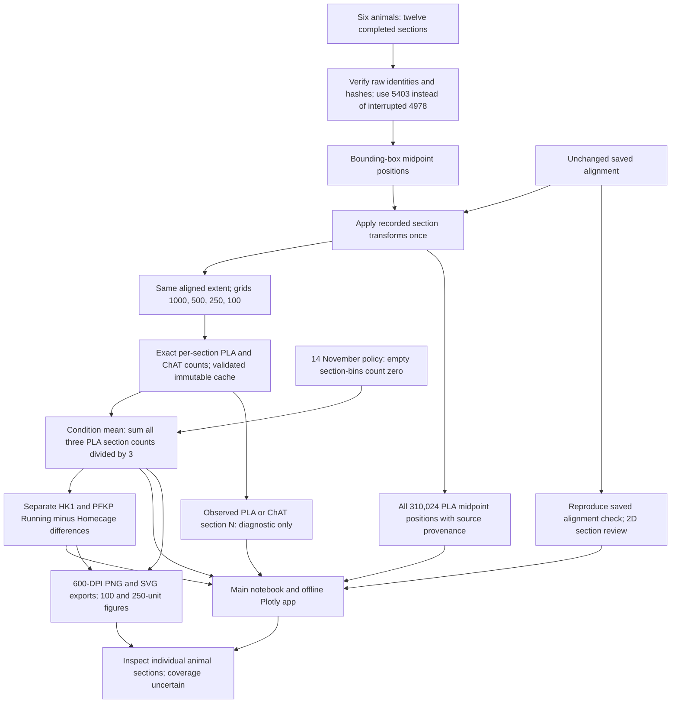

# Experiment-to-results workflow

Current authority: [the 14 November scientist clarification](scientist_clarifications_2026-11-14.md). Average all three sections per condition, include empty section-bins as zero, and label coverage uncertain. The selected cohort and fixed alignment are established; no further asset requests block this workflow.

The default detailed view uses 100-export-unit bins. The 1,000-, 500- and 250-unit grids are available as coarser views of the same counted objects. Each raw object enters one section-bin without sampling, new registration, smoothing or interpolation. The same animals occur in both arms, so HK1 and PFKP are processed separately rather than counted as independent animal replications.

The numerical mean always divides by three. A section with no detected PLA in a bin contributes zero whether or not ChAT objects are present. Observed-object N cannot change that denominator. Each arm's plots show the union of bins with any observed PLA/ChAT objects across its six sections; outside that display domain the plots are blank, while full-grid arithmetic values remain saved. Neither the display domain nor an N of three verifies tissue coverage.

The current presentation is 2D. Physical-distance labels and scale bars are omitted. Earlier observed-N means and the original strict-mask PDF specification remain historical provenance; their former input requests are not current gates. The original PDF's mask requirement (p. 1, sections 3-4) is not claimed to have been satisfied by the mask-free current analysis. See [methods](exploratory_methods.md), [derived dictionary](derived_data_dictionary.md) and [rerun instructions](../README.md).
